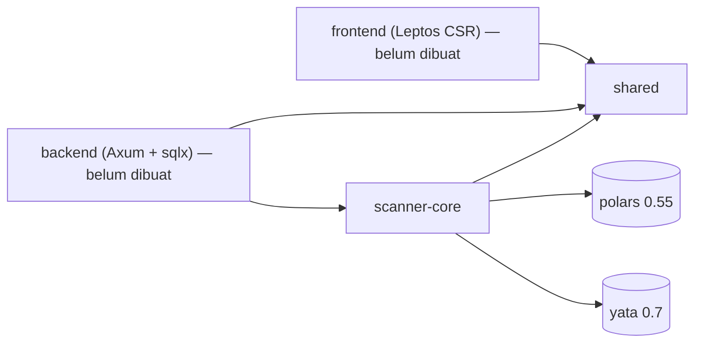
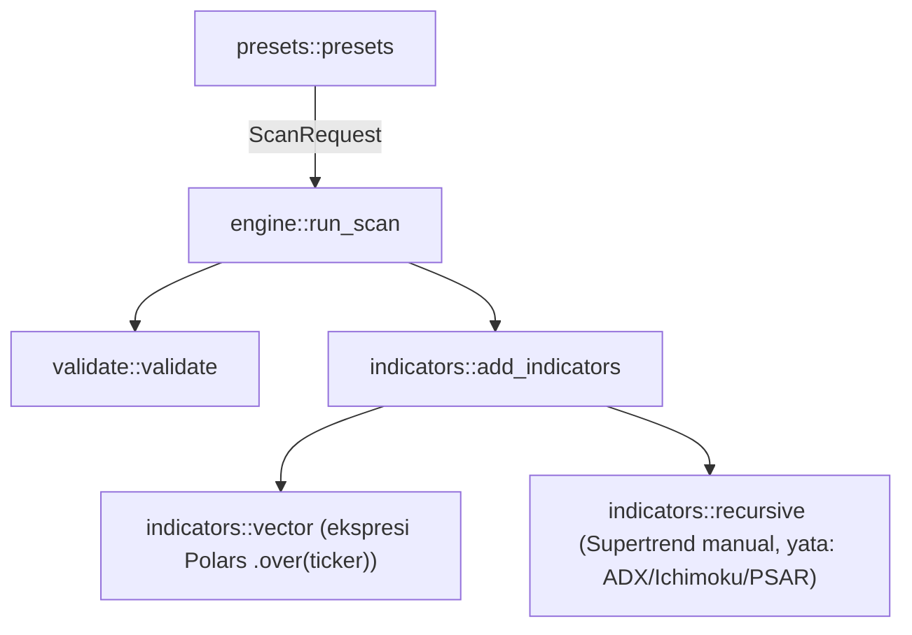
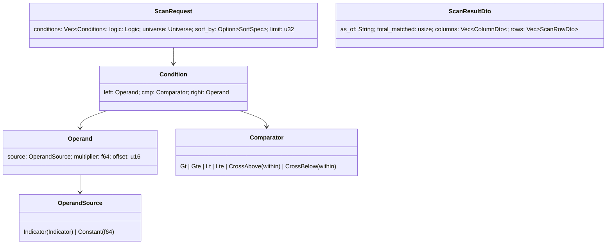
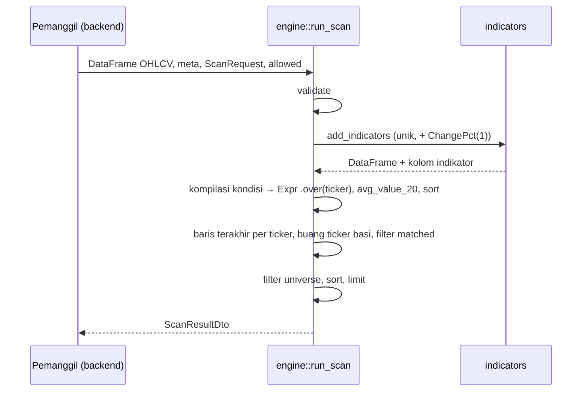

# Scanner Saham — Rencana 1: `shared` + `scanner-core`

> **For agentic workers:** REQUIRED SUB-SKILL: Use superpowers:subagent-driven-development (recommended) or superpowers:executing-plans to implement this plan task-by-task. Steps use checkbox (`- [ ]`) syntax for tracking.

**Goal:** Membangun crate tipe bersama (`shared`) dan engine analisa (`scanner-core`) yang menghitung indikator teknikal dan menjalankan aturan scan atas `DataFrame` OHLCV multi-ticker.

**Architecture:** Cargo workspace virtual. `shared` hanya berisi tipe serde (aman untuk WASM). `scanner-core` murni komputasi tanpa IO: indikator vektor sebagai ekspresi Polars per ticker (`.over("ticker")`), indikator rekursif (Supertrend manual; ADX, Ichimoku, dan PSAR via yata) dihitung per grup ticker, dan engine mengompilasi `ScanRequest` menjadi ekspresi filter Polars.

**Tech Stack:** Rust 1.97 (edition 2024), polars 0.55, yata 0.7, serde 1, thiserror 2, chrono 0.4.

Spec: `docs/superpowers/specs/2026-10-15-scanner-saham-design.md` (bagian 2.1, 2.2, 4).

## Global Constraints

- Edition `2024`, workspace `resolver = "3"`.
- Nama package: `shared` (direktori `crates/shared`) dan `scanner-core` (direktori `crates/core`, di-import sebagai `scanner_core`).
- `shared` hanya boleh bergantung pada `serde`, supaya bisa dikompilasi ke `wasm32-unknown-unknown`.
- `scanner-core` tidak boleh melakukan IO (jaringan, file, database).
- polars `0.55`, `default-features = false`, fitur: `lazy`, `rolling_window`, `ewma`, `dtype-date`, `temporal`, `abs`, `fmt`.
- yata `0.7`, `default-features = false`, fitur `period_type_u16`.
- Skema `DataFrame` input: `ticker: str, date: date, open: f64, high: f64, low: f64, close: f64, volume: f64` (harga sudah disesuaikan).
- Batas validasi: periode 1–500, kondisi 1–10, limit 1–500 (default 100), `within` 1–20, offset 0–20.
- Pesan error untuk pengguna ditulis dalam Bahasa Indonesia.
- Catatan API polars 0.55 yang sudah diverifikasi: `Expr::over(..)` mengembalikan `PolarsResult<Expr>`; `Expr` tidak mengimplementasi `&`, jadi pakai `.and()`; `max_horizontal` harus ditulis lengkap sebagai `polars::lazy::dsl::max_horizontal` (ada nama ganda di prelude); `all().exclude_cols([..]).as_expr()` untuk memilih semua kolom kecuali yang dikecualikan.
- Setelah setiap task yang mengubah kode, perbarui `docs/architecture.md` (Task 7 membuat file ini; task sesudahnya memperbaruinya).

---

## Struktur File

```
Cargo.toml                          # workspace virtual (ganti package lama)
src/main.rs                         # DIHAPUS
crates/shared/Cargo.toml
crates/shared/src/lib.rs            # re-export
crates/shared/src/indicator.rs      # enum Indicator + key/label/lookback/periods/is_recursive
crates/shared/src/scan.rs           # ScanRequest, Condition, Operand, Comparator, Universe, DTO hasil, PresetDto
crates/core/Cargo.toml
crates/core/src/lib.rs
crates/core/src/error.rs            # CoreError
crates/core/src/testutil.rs         # pembuat DataFrame sintetis (khusus test)
crates/core/src/indicators/mod.rs   # add_indicators()
crates/core/src/indicators/vector.rs     # ekspresi Polars
crates/core/src/indicators/recursive.rs  # Supertrend + yata
crates/core/src/validate.rs         # validate(ScanRequest)
crates/core/src/engine.rs           # run_scan(), StockMeta, format_day()
crates/core/src/presets.rs          # presets()
docs/architecture.md
```

---

### Task 1: Workspace + crate `shared`

**Files:**
- Modify: `Cargo.toml` (ganti seluruh isi)
- Delete: `src/main.rs`
- Create: `crates/shared/Cargo.toml`, `crates/shared/src/lib.rs`, `crates/shared/src/indicator.rs`, `crates/shared/src/scan.rs`

**Interfaces:**
- Produces: `shared::Indicator` (`key() -> String`, `label() -> String`, `lookback() -> usize`, `periods() -> Vec<u16>`, `is_recursive() -> bool`), `shared::{ScanRequest (::new), Logic, Universe, SortSpec, Condition (::new), Operand (::indicator, ::constant, .times, .shifted, .as_indicator), OperandSource, Comparator, ColumnDto, ScanRowDto, ScanResultDto, PresetDto, DEFAULT_LIMIT}`.

- [ ] **Step 1: Ganti `Cargo.toml` root menjadi workspace dan hapus `src/main.rs`**

```toml
[workspace]
resolver = "3"
members = ["crates/shared", "crates/core"]

[workspace.package]
version = "0.1.0"
edition = "2024"

[workspace.dependencies]
shared = { path = "crates/shared" }
scanner-core = { path = "crates/core" }
serde = { version = "1", features = ["derive"] }
serde_json = "1"
thiserror = "2"
chrono = { version = "0.4", default-features = false, features = ["std"] }
polars = { version = "0.55", default-features = false, features = ["lazy", "rolling_window", "ewma", "dtype-date", "temporal", "abs", "fmt"] }
yata = { version = "0.7", default-features = false, features = ["period_type_u16"] }
```

Run: `rm -r src`

- [ ] **Step 2: Buat `crates/shared/Cargo.toml`**

```toml
[package]
name = "shared"
version.workspace = true
edition.workspace = true

[dependencies]
serde.workspace = true

[dev-dependencies]
serde_json.workspace = true
```

- [ ] **Step 3: Tulis test yang gagal di `crates/shared/src/indicator.rs`** (bagian test saja dulu, tipe menyusul di Step 5)

```rust
#[cfg(test)]
mod tests {
    use super::Indicator::*;
    use super::*;

    #[test]
    fn keys_are_stable() {
        assert_eq!(Sma { period: 50 }.key(), "sma_50");
        assert_eq!(MacdSignal { fast: 12, slow: 26, signal: 9 }.key(), "macd_signal_12_26_9");
        assert_eq!(BbUpper { period: 20, std_x10: 20 }.key(), "bb_upper_20_20");
        let lowest = LowestOf { inner: Box::new(BbWidth { period: 20, std_x10: 20 }), period: 120 };
        assert_eq!(lowest.key(), "lowest_120_of_bb_width_20_20");
        assert_eq!(Close.key(), "close");
    }

    #[test]
    fn labels_are_readable() {
        assert_eq!(Sma { period: 50 }.label(), "SMA(50)");
        assert_eq!(BbUpper { period: 20, std_x10: 20 }.label(), "BB Upper(20, 2.0)");
        assert_eq!(Supertrend { period: 10, mult_x10: 30 }.label(), "Supertrend(10, 3.0)");
        assert_eq!(ParabolicSar { step_x1000: 20, max_x1000: 200 }.label(), "PSAR(0.020, 0.200)");
    }

    #[test]
    fn lookback_and_periods() {
        assert_eq!(MacdSignal { fast: 12, slow: 26, signal: 9 }.lookback(), 34);
        assert_eq!(Rsi { period: 14 }.lookback(), 15);
        let lowest = LowestOf { inner: Box::new(Sma { period: 20 }), period: 120 };
        assert_eq!(lowest.lookback(), 139);
        assert_eq!(lowest.periods(), vec![20, 120]);
        assert!(Close.periods().is_empty());
    }

    #[test]
    fn recursive_flag() {
        assert!(Supertrend { period: 10, mult_x10: 30 }.is_recursive());
        assert!(Adx { period: 14 }.is_recursive());
        assert!(!Sma { period: 10 }.is_recursive());
    }

    #[test]
    fn json_shape() {
        let json = serde_json::to_string(&Sma { period: 50 }).unwrap();
        assert_eq!(json, r#"{"kind":"sma","period":50}"#);
        let back: Indicator = serde_json::from_str(r#"{"kind":"close"}"#).unwrap();
        assert_eq!(back, Close);
        let nested: Indicator = serde_json::from_str(
            r#"{"kind":"lowest_of","inner":{"kind":"bb_width","period":20,"std_x10":20},"period":120}"#,
        )
        .unwrap();
        assert_eq!(nested.key(), "lowest_120_of_bb_width_20_20");
    }
}
```

- [ ] **Step 4: Jalankan test, pastikan gagal**

Buat `crates/shared/src/lib.rs` sementara berisi `pub mod indicator;`.
Run: `cargo test -p shared`
Expected: FAIL, error kompilasi `cannot find type Indicator`.

- [ ] **Step 5: Implementasikan `Indicator` di atas blok test pada `crates/shared/src/indicator.rs`**

```rust
use serde::{Deserialize, Serialize};

/// Indikator teknikal yang bisa dipakai di aturan scan dan chart.
/// Parameter pecahan disimpan sebagai integer berskala (`std_x10 = 20` → 2.0)
/// supaya tipe ini bisa `Eq + Hash` dan key kolomnya stabil.
#[derive(Debug, Clone, PartialEq, Eq, Hash, Serialize, Deserialize)]
#[serde(tag = "kind", rename_all = "snake_case")]
pub enum Indicator {
    Open,
    High,
    Low,
    Close,
    Volume,
    ChangePct { period: u16 },
    Sma { period: u16 },
    Ema { period: u16 },
    VolumeSma { period: u16 },
    Rsi { period: u16 },
    MacdLine { fast: u16, slow: u16, signal: u16 },
    MacdSignal { fast: u16, slow: u16, signal: u16 },
    MacdHist { fast: u16, slow: u16, signal: u16 },
    BbUpper { period: u16, std_x10: u16 },
    BbMiddle { period: u16, std_x10: u16 },
    BbLower { period: u16, std_x10: u16 },
    BbWidth { period: u16, std_x10: u16 },
    Atr { period: u16 },
    StochK { period: u16, smooth: u16 },
    StochD { period: u16, smooth: u16, d: u16 },
    HighestHigh { period: u16 },
    LowestLow { period: u16 },
    /// Nilai minimum `inner` dalam `period` bar terakhir.
    LowestOf { inner: Box<Indicator>, period: u16 },
    Supertrend { period: u16, mult_x10: u16 },
    Adx { period: u16 },
    PlusDi { period: u16 },
    MinusDi { period: u16 },
    IchimokuTenkan { tenkan: u16, kijun: u16, senkou_b: u16 },
    IchimokuKijun { tenkan: u16, kijun: u16, senkou_b: u16 },
    IchimokuSenkouA { tenkan: u16, kijun: u16, senkou_b: u16 },
    IchimokuSenkouB { tenkan: u16, kijun: u16, senkou_b: u16 },
    ParabolicSar { step_x1000: u16, max_x1000: u16 },
}

fn x10(v: u16) -> String {
    format!("{:.1}", f64::from(v) / 10.0)
}

fn x1000(v: u16) -> String {
    format!("{:.3}", f64::from(v) / 1000.0)
}

impl Indicator {
    /// Nama kolom yang stabil, dipakai backend dan frontend.
    pub fn key(&self) -> String {
        use Indicator::*;
        match self {
            Open => "open".into(),
            High => "high".into(),
            Low => "low".into(),
            Close => "close".into(),
            Volume => "volume".into(),
            ChangePct { period } => format!("change_pct_{period}"),
            Sma { period } => format!("sma_{period}"),
            Ema { period } => format!("ema_{period}"),
            VolumeSma { period } => format!("volume_sma_{period}"),
            Rsi { period } => format!("rsi_{period}"),
            MacdLine { fast, slow, signal } => format!("macd_line_{fast}_{slow}_{signal}"),
            MacdSignal { fast, slow, signal } => format!("macd_signal_{fast}_{slow}_{signal}"),
            MacdHist { fast, slow, signal } => format!("macd_hist_{fast}_{slow}_{signal}"),
            BbUpper { period, std_x10 } => format!("bb_upper_{period}_{std_x10}"),
            BbMiddle { period, std_x10 } => format!("bb_middle_{period}_{std_x10}"),
            BbLower { period, std_x10 } => format!("bb_lower_{period}_{std_x10}"),
            BbWidth { period, std_x10 } => format!("bb_width_{period}_{std_x10}"),
            Atr { period } => format!("atr_{period}"),
            StochK { period, smooth } => format!("stoch_k_{period}_{smooth}"),
            StochD { period, smooth, d } => format!("stoch_d_{period}_{smooth}_{d}"),
            HighestHigh { period } => format!("highest_high_{period}"),
            LowestLow { period } => format!("lowest_low_{period}"),
            LowestOf { inner, period } => format!("lowest_{period}_of_{}", inner.key()),
            Supertrend { period, mult_x10 } => format!("supertrend_{period}_{mult_x10}"),
            Adx { period } => format!("adx_{period}"),
            PlusDi { period } => format!("plus_di_{period}"),
            MinusDi { period } => format!("minus_di_{period}"),
            IchimokuTenkan { tenkan, kijun, senkou_b } => {
                format!("ichimoku_tenkan_{tenkan}_{kijun}_{senkou_b}")
            }
            IchimokuKijun { tenkan, kijun, senkou_b } => {
                format!("ichimoku_kijun_{tenkan}_{kijun}_{senkou_b}")
            }
            IchimokuSenkouA { tenkan, kijun, senkou_b } => {
                format!("ichimoku_senkou_a_{tenkan}_{kijun}_{senkou_b}")
            }
            IchimokuSenkouB { tenkan, kijun, senkou_b } => {
                format!("ichimoku_senkou_b_{tenkan}_{kijun}_{senkou_b}")
            }
            ParabolicSar { step_x1000, max_x1000 } => format!("psar_{step_x1000}_{max_x1000}"),
        }
    }

    /// Nama yang mudah dibaca untuk header tabel dan UI.
    pub fn label(&self) -> String {
        use Indicator::*;
        match self {
            Open => "Open".into(),
            High => "High".into(),
            Low => "Low".into(),
            Close => "Close".into(),
            Volume => "Volume".into(),
            ChangePct { period } => format!("Change%({period})"),
            Sma { period } => format!("SMA({period})"),
            Ema { period } => format!("EMA({period})"),
            VolumeSma { period } => format!("Vol SMA({period})"),
            Rsi { period } => format!("RSI({period})"),
            MacdLine { fast, slow, signal } => format!("MACD({fast}, {slow}, {signal})"),
            MacdSignal { fast, slow, signal } => format!("MACD Signal({fast}, {slow}, {signal})"),
            MacdHist { fast, slow, signal } => format!("MACD Hist({fast}, {slow}, {signal})"),
            BbUpper { period, std_x10 } => format!("BB Upper({period}, {})", x10(*std_x10)),
            BbMiddle { period, std_x10 } => format!("BB Middle({period}, {})", x10(*std_x10)),
            BbLower { period, std_x10 } => format!("BB Lower({period}, {})", x10(*std_x10)),
            BbWidth { period, std_x10 } => format!("BB Width({period}, {})", x10(*std_x10)),
            Atr { period } => format!("ATR({period})"),
            StochK { period, smooth } => format!("Stoch %K({period}, {smooth})"),
            StochD { period, smooth, d } => format!("Stoch %D({period}, {smooth}, {d})"),
            HighestHigh { period } => format!("Highest High({period})"),
            LowestLow { period } => format!("Lowest Low({period})"),
            LowestOf { inner, period } => format!("Lowest {period} of {}", inner.label()),
            Supertrend { period, mult_x10 } => format!("Supertrend({period}, {})", x10(*mult_x10)),
            Adx { period } => format!("ADX({period})"),
            PlusDi { period } => format!("+DI({period})"),
            MinusDi { period } => format!("-DI({period})"),
            IchimokuTenkan { tenkan, kijun, senkou_b } => format!("Tenkan({tenkan}, {kijun}, {senkou_b})"),
            IchimokuKijun { tenkan, kijun, senkou_b } => format!("Kijun({tenkan}, {kijun}, {senkou_b})"),
            IchimokuSenkouA { tenkan, kijun, senkou_b } => format!("Senkou A({tenkan}, {kijun}, {senkou_b})"),
            IchimokuSenkouB { tenkan, kijun, senkou_b } => format!("Senkou B({tenkan}, {kijun}, {senkou_b})"),
            ParabolicSar { step_x1000, max_x1000 } => {
                format!("PSAR({}, {})", x1000(*step_x1000), x1000(*max_x1000))
            }
        }
    }

    /// Jumlah bar minimum agar indikator punya nilai.
    pub fn lookback(&self) -> usize {
        use Indicator::*;
        let n = |v: &u16| usize::from(*v);
        match self {
            Open | High | Low | Close | Volume => 1,
            ParabolicSar { .. } => 2,
            ChangePct { period } | Rsi { period } | PlusDi { period } | MinusDi { period } => n(period) + 1,
            Sma { period }
            | Ema { period }
            | VolumeSma { period }
            | Atr { period }
            | HighestHigh { period }
            | LowestLow { period }
            | Supertrend { period, .. }
            | BbUpper { period, .. }
            | BbMiddle { period, .. }
            | BbLower { period, .. }
            | BbWidth { period, .. } => n(period),
            MacdLine { slow, .. } => n(slow),
            MacdSignal { slow, signal, .. } | MacdHist { slow, signal, .. } => n(slow) + n(signal) - 1,
            StochK { period, smooth } => n(period) + n(smooth) - 1,
            StochD { period, smooth, d } => n(period) + n(smooth) + n(d) - 2,
            LowestOf { inner, period } => inner.lookback() + n(period) - 1,
            Adx { period } => 2 * n(period),
            IchimokuTenkan { tenkan, .. } => n(tenkan),
            IchimokuKijun { kijun, .. } => n(kijun),
            IchimokuSenkouA { kijun, .. } => 2 * n(kijun),
            IchimokuSenkouB { kijun, senkou_b, .. } => n(senkou_b) + n(kijun),
        }
    }

    /// Semua parameter periode, untuk validasi rentang.
    pub fn periods(&self) -> Vec<u16> {
        use Indicator::*;
        match self {
            Open | High | Low | Close | Volume | ParabolicSar { .. } => vec![],
            ChangePct { period }
            | Sma { period }
            | Ema { period }
            | VolumeSma { period }
            | Rsi { period }
            | Atr { period }
            | HighestHigh { period }
            | LowestLow { period }
            | Adx { period }
            | PlusDi { period }
            | MinusDi { period }
            | Supertrend { period, .. }
            | BbUpper { period, .. }
            | BbMiddle { period, .. }
            | BbLower { period, .. }
            | BbWidth { period, .. } => vec![*period],
            MacdLine { fast, slow, signal }
            | MacdSignal { fast, slow, signal }
            | MacdHist { fast, slow, signal } => vec![*fast, *slow, *signal],
            StochK { period, smooth } => vec![*period, *smooth],
            StochD { period, smooth, d } => vec![*period, *smooth, *d],
            LowestOf { inner, period } => {
                let mut v = inner.periods();
                v.push(*period);
                v
            }
            IchimokuTenkan { tenkan, kijun, senkou_b }
            | IchimokuKijun { tenkan, kijun, senkou_b }
            | IchimokuSenkouA { tenkan, kijun, senkou_b }
            | IchimokuSenkouB { tenkan, kijun, senkou_b } => vec![*tenkan, *kijun, *senkou_b],
        }
    }

    /// Indikator rekursif dihitung per ticker di luar ekspresi Polars.
    pub fn is_recursive(&self) -> bool {
        use Indicator::*;
        matches!(
            self,
            Supertrend { .. }
                | Adx { .. }
                | PlusDi { .. }
                | MinusDi { .. }
                | IchimokuTenkan { .. }
                | IchimokuKijun { .. }
                | IchimokuSenkouA { .. }
                | IchimokuSenkouB { .. }
                | ParabolicSar { .. }
        )
    }
}
```

- [ ] **Step 6: Tulis test yang gagal di `crates/shared/src/scan.rs`** (bagian test saja dulu)

```rust
#[cfg(test)]
mod tests {
    use super::*;
    use crate::Indicator;

    #[test]
    fn minimal_json_uses_defaults() {
        let req: ScanRequest = serde_json::from_str(
            r#"{"conditions":[{"left":{"source":{"indicator":{"kind":"rsi","period":14}}},
                               "cmp":{"op":"cross_above"},
                               "right":{"source":{"constant":30.0}}}]}"#,
        )
        .unwrap();
        assert_eq!(req.logic, Logic::All);
        assert_eq!(req.limit, DEFAULT_LIMIT);
        assert_eq!(req.universe, Universe::default());
        let c = &req.conditions[0];
        assert_eq!(c.cmp, Comparator::CrossAbove { within: 1 });
        assert_eq!(c.left.multiplier, 1.0);
        assert_eq!(c.left.offset, 0);
        assert_eq!(c.left.as_indicator(), Some(&Indicator::Rsi { period: 14 }));
        assert_eq!(c.right.as_indicator(), None);
    }

    #[test]
    fn builders_round_trip() {
        let req = ScanRequest::new(vec![Condition::new(
            Operand::indicator(Indicator::Volume),
            Comparator::Gt,
            Operand::indicator(Indicator::VolumeSma { period: 20 }).times(2.0).shifted(1),
        )]);
        let json = serde_json::to_string(&req).unwrap();
        let back: ScanRequest = serde_json::from_str(&json).unwrap();
        assert_eq!(back, req);
        assert_eq!(back.conditions[0].right.multiplier, 2.0);
        assert_eq!(back.conditions[0].right.offset, 1);
    }
}
```

- [ ] **Step 7: Jalankan test, pastikan gagal**

Ganti `crates/shared/src/lib.rs` menjadi:

```rust
pub mod indicator;
pub mod scan;

pub use indicator::Indicator;
pub use scan::*;
```

Run: `cargo test -p shared`
Expected: FAIL, error kompilasi `cannot find type ScanRequest`.

- [ ] **Step 8: Implementasikan tipe scan di atas blok test pada `crates/shared/src/scan.rs`**

```rust
use std::collections::BTreeMap;

use serde::{Deserialize, Serialize};

use crate::Indicator;

pub const DEFAULT_LIMIT: u32 = 100;

fn default_limit() -> u32 {
    DEFAULT_LIMIT
}

fn default_multiplier() -> f64 {
    1.0
}

fn default_within() -> u8 {
    1
}

fn default_true() -> bool {
    true
}

#[derive(Debug, Clone, PartialEq, Serialize, Deserialize)]
pub struct ScanRequest {
    pub conditions: Vec<Condition>,
    #[serde(default)]
    pub logic: Logic,
    #[serde(default)]
    pub universe: Universe,
    #[serde(default)]
    pub sort_by: Option<SortSpec>,
    #[serde(default = "default_limit")]
    pub limit: u32,
}

impl ScanRequest {
    pub fn new(conditions: Vec<Condition>) -> Self {
        Self {
            conditions,
            logic: Logic::All,
            universe: Universe::default(),
            sort_by: None,
            limit: DEFAULT_LIMIT,
        }
    }
}

#[derive(Debug, Clone, Copy, Default, PartialEq, Eq, Serialize, Deserialize)]
#[serde(rename_all = "snake_case")]
pub enum Logic {
    #[default]
    All,
    Any,
}

#[derive(Debug, Clone, Default, PartialEq, Serialize, Deserialize)]
#[serde(default)]
pub struct Universe {
    pub min_price: Option<f64>,
    pub max_price: Option<f64>,
    /// Rata-rata `close × volume` 20 hari, dalam Rupiah.
    pub min_avg_value_20d: Option<f64>,
    /// Kosong = semua sektor.
    pub sectors: Vec<String>,
    /// Kosong = semua papan.
    pub boards: Vec<String>,
    pub watchlist_id: Option<i64>,
}

#[derive(Debug, Clone, PartialEq, Serialize, Deserialize)]
pub struct SortSpec {
    pub operand: Operand,
    #[serde(default = "default_true")]
    pub descending: bool,
}

#[derive(Debug, Clone, PartialEq, Serialize, Deserialize)]
pub struct Condition {
    pub left: Operand,
    pub cmp: Comparator,
    pub right: Operand,
}

impl Condition {
    pub fn new(left: Operand, cmp: Comparator, right: Operand) -> Self {
        Self { left, cmp, right }
    }
}

#[derive(Debug, Clone, PartialEq, Serialize, Deserialize)]
pub struct Operand {
    pub source: OperandSource,
    #[serde(default = "default_multiplier")]
    pub multiplier: f64,
    /// Ambil nilai N bar ke belakang (0 = bar terakhir). Diabaikan untuk konstanta.
    #[serde(default)]
    pub offset: u16,
}

impl Operand {
    pub fn indicator(ind: Indicator) -> Self {
        Self { source: OperandSource::Indicator(ind), multiplier: 1.0, offset: 0 }
    }

    pub fn constant(value: f64) -> Self {
        Self { source: OperandSource::Constant(value), multiplier: 1.0, offset: 0 }
    }

    pub fn times(mut self, multiplier: f64) -> Self {
        self.multiplier = multiplier;
        self
    }

    pub fn shifted(mut self, bars: u16) -> Self {
        self.offset = bars;
        self
    }

    pub fn as_indicator(&self) -> Option<&Indicator> {
        match &self.source {
            OperandSource::Indicator(ind) => Some(ind),
            OperandSource::Constant(_) => None,
        }
    }
}

#[derive(Debug, Clone, PartialEq, Serialize, Deserialize)]
#[serde(rename_all = "snake_case")]
pub enum OperandSource {
    Indicator(Indicator),
    Constant(f64),
}

#[derive(Debug, Clone, Copy, PartialEq, Eq, Serialize, Deserialize)]
#[serde(tag = "op", rename_all = "snake_case")]
pub enum Comparator {
    Gt,
    Gte,
    Lt,
    Lte,
    /// `left` memotong ke atas `right` dalam `within` bar terakhir.
    CrossAbove {
        #[serde(default = "default_within")]
        within: u8,
    },
    CrossBelow {
        #[serde(default = "default_within")]
        within: u8,
    },
}

#[derive(Debug, Clone, PartialEq, Eq, Serialize, Deserialize)]
pub struct ColumnDto {
    pub key: String,
    pub label: String,
}

#[derive(Debug, Clone, PartialEq, Serialize, Deserialize)]
pub struct ScanRowDto {
    pub ticker: String,
    pub name: String,
    pub close: f64,
    pub change_pct: Option<f64>,
    pub volume: f64,
    pub avg_value_20: Option<f64>,
    /// Nilai setiap indikator di `ScanResultDto::columns`, dengan `ColumnDto::key` sebagai kunci.
    pub values: BTreeMap<String, Option<f64>>,
}

#[derive(Debug, Clone, PartialEq, Serialize, Deserialize)]
pub struct ScanResultDto {
    /// Tanggal bar terakhir, format `YYYY-MM-DD`.
    pub as_of: String,
    pub total_matched: usize,
    pub columns: Vec<ColumnDto>,
    pub rows: Vec<ScanRowDto>,
}

#[derive(Debug, Clone, PartialEq, Serialize, Deserialize)]
pub struct PresetDto {
    pub id: String,
    pub name: String,
    pub description: String,
    pub request: ScanRequest,
}
```

- [ ] **Step 9: Jalankan test, pastikan lolos**

Run: `cargo test -p shared`
Expected: PASS, 7 test.

- [ ] **Step 10: Commit**

```bash
git add Cargo.toml Cargo.lock .gitignore crates/shared
git commit -m "feat(shared): workspace dan tipe aturan scan"
```

---

### Task 2: `scanner-core`: kerangka, testutil, dan indikator vektor (Polars)

**Files:**
- Modify: `Cargo.toml` (tidak ada perubahan; `crates/core` sudah terdaftar)
- Create: `crates/core/Cargo.toml`, `crates/core/src/lib.rs`, `crates/core/src/error.rs`, `crates/core/src/testutil.rs`, `crates/core/src/indicators/mod.rs`, `crates/core/src/indicators/vector.rs`

**Interfaces:**
- Consumes: `shared::Indicator`.
- Produces: `scanner_core::CoreError { Invalid(String), Compute(PolarsError) }`; `scanner_core::indicators::vector::{raw(&Indicator) -> Result<Expr, CoreError>, expr(&Indicator) -> Result<Expr, CoreError>, window(u16) -> RollingOptionsFixedWindow}`; test helpers `crate::testutil::{BASE_DAY, Bar, bars, closes, closes_volumes, wave, values, values_for, assert_close}`.

- [ ] **Step 1: Buat `crates/core/Cargo.toml`, `lib.rs`, `error.rs`, `indicators/mod.rs`**

`crates/core/Cargo.toml`:

```toml
[package]
name = "scanner-core"
version.workspace = true
edition.workspace = true

[dependencies]
shared.workspace = true
polars.workspace = true
yata.workspace = true
thiserror.workspace = true
chrono.workspace = true
```

`crates/core/src/lib.rs`:

```rust
//! Engine analisa saham: indikator teknikal dan scan atas DataFrame OHLCV multi-ticker.
//! Tidak melakukan IO; input dan output berupa `DataFrame` dan tipe dari `shared`.

pub mod error;
pub mod indicators;

#[cfg(test)]
mod testutil;

pub use error::CoreError;
```

`crates/core/src/error.rs`:

```rust
use polars::prelude::PolarsError;

#[derive(Debug, thiserror::Error)]
pub enum CoreError {
    /// Input dari pengguna tidak valid; pesannya aman untuk ditampilkan.
    #[error("{0}")]
    Invalid(String),
    #[error("gagal menghitung data: {0}")]
    Compute(#[from] PolarsError),
}
```

`crates/core/src/indicators/mod.rs`:

```rust
pub mod vector;
```

- [ ] **Step 2: Buat `crates/core/src/testutil.rs`**

```rust
//! Pembuat DataFrame sintetis untuk test.

use polars::prelude::*;

/// Hari pertama data sintetis (2024-10-04), dalam hari sejak 1970-01-01.
pub const BASE_DAY: i32 = 20_000;

/// Satu bar: `[open, high, low, close, volume]`.
pub type Bar = [f64; 5];

/// Bar ke-i setiap ticker diberi tanggal `BASE_DAY + i`, jadi seri yang lebih pendek
/// berakhir di tanggal yang lebih awal.
pub fn bars(series: &[(&str, Vec<Bar>)]) -> DataFrame {
    let (mut ticker, mut date) = (Vec::new(), Vec::new());
    let (mut o, mut h, mut l, mut c, mut v) = (Vec::new(), Vec::new(), Vec::new(), Vec::new(), Vec::new());
    for (t, bs) in series {
        for (i, b) in bs.iter().enumerate() {
            ticker.push(t.to_string());
            date.push(BASE_DAY + i as i32);
            o.push(b[0]);
            h.push(b[1]);
            l.push(b[2]);
            c.push(b[3]);
            v.push(b[4]);
        }
    }
    let mut df = df!(
        "ticker" => ticker,
        "open" => o,
        "high" => h,
        "low" => l,
        "close" => c,
        "volume" => v,
    )
    .unwrap();
    df.with_column(Column::new("date".into(), date).cast(&DataType::Date).unwrap()).unwrap();
    df
}

/// OHLC = close, volume = 1.000.000.
pub fn closes(series: &[(&str, Vec<f64>)]) -> DataFrame {
    let s: Vec<(&str, Vec<f64>, Vec<f64>)> =
        series.iter().map(|(t, cs)| (*t, cs.clone(), vec![1_000_000.0; cs.len()])).collect();
    closes_volumes(&s)
}

pub fn closes_volumes(series: &[(&str, Vec<f64>, Vec<f64>)]) -> DataFrame {
    let s: Vec<(&str, Vec<Bar>)> = series
        .iter()
        .map(|(t, cs, vs)| (*t, cs.iter().zip(vs).map(|(&c, &v)| [c, c, c, c, v]).collect()))
        .collect();
    bars(&s)
}

/// Seri bergelombang yang deterministik.
pub fn wave(n: usize, base: f64, amp: f64, drift: f64) -> Vec<f64> {
    (0..n).map(|i| base + (i as f64 * 0.37).sin() * amp + i as f64 * drift).collect()
}

pub fn values(df: &DataFrame, name: &str) -> Vec<Option<f64>> {
    df.column(name).unwrap().f64().unwrap().into_iter().collect()
}

pub fn values_for(df: &DataFrame, ticker: &str, name: &str) -> Vec<Option<f64>> {
    let tickers = df.column("ticker").unwrap().str().unwrap();
    tickers
        .into_iter()
        .zip(values(df, name))
        .filter(|(t, _)| *t == Some(ticker))
        .map(|(_, v)| v)
        .collect()
}

pub fn assert_close(actual: &[Option<f64>], expected: &[Option<f64>]) {
    assert_eq!(actual.len(), expected.len(), "panjang berbeda");
    for (i, (a, e)) in actual.iter().zip(expected).enumerate() {
        match (a, e) {
            (None, None) => {}
            (Some(a), Some(e)) => assert!((a - e).abs() < 1e-6, "index {i}: {a} != {e}"),
            _ => panic!("index {i}: {a:?} != {e:?}"),
        }
    }
}
```

- [ ] **Step 3: Tulis test yang gagal di `crates/core/src/indicators/vector.rs`** (bagian test saja dulu)

```rust
#[cfg(test)]
mod tests {
    use super::*;
    use crate::testutil::*;

    fn eval(df: &DataFrame, ind: &Indicator) -> Vec<Option<f64>> {
        let out = df.clone().lazy().with_column(expr(ind).unwrap().alias("out")).collect().unwrap();
        values(&out, "out")
    }

    fn sma_ref(x: &[f64], n: usize) -> Vec<Option<f64>> {
        (0..x.len())
            .map(|i| (i + 1 >= n).then(|| x[i + 1 - n..=i].iter().sum::<f64>() / n as f64))
            .collect()
    }

    /// EWM `adjust=false`, dimulai dari nilai non-null pertama.
    fn ewm_ref(x: &[Option<f64>], alpha: f64, min_periods: usize) -> Vec<Option<f64>> {
        let (mut state, mut count) = (None::<f64>, 0);
        x.iter()
            .map(|v| {
                let v = (*v)?;
                count += 1;
                let s = state.map_or(v, |p| (1.0 - alpha) * p + alpha * v);
                state = Some(s);
                (count >= min_periods).then_some(s)
            })
            .collect()
    }

    fn std_ref(x: &[f64], n: usize) -> Vec<Option<f64>> {
        (0..x.len())
            .map(|i| {
                (i + 1 >= n).then(|| {
                    let w = &x[i + 1 - n..=i];
                    let m = w.iter().sum::<f64>() / n as f64;
                    (w.iter().map(|v| (v - m).powi(2)).sum::<f64>() / n as f64).sqrt()
                })
            })
            .collect()
    }

    fn some(x: &[f64]) -> Vec<Option<f64>> {
        x.iter().copied().map(Some).collect()
    }

    fn sample() -> Vec<f64> {
        wave(60, 100.0, 8.0, 0.1)
    }

    #[test]
    fn sma_and_ema() {
        let x = sample();
        let df = closes(&[("A", x.clone())]);
        assert_close(&eval(&df, &Indicator::Sma { period: 5 }), &sma_ref(&x, 5));
        assert_close(&eval(&df, &Indicator::Ema { period: 5 }), &ewm_ref(&some(&x), 2.0 / 6.0, 5));
    }

    #[test]
    fn rsi_wilder() {
        let x = sample();
        let df = closes(&[("A", x.clone())]);
        let diff: Vec<Option<f64>> =
            (0..x.len()).map(|i| (i > 0).then(|| x[i] - x[i - 1])).collect();
        let gain: Vec<Option<f64>> = diff.iter().map(|d| d.map(|d| d.max(0.0))).collect();
        let loss: Vec<Option<f64>> = diff.iter().map(|d| d.map(|d| (-d).max(0.0))).collect();
        let (g, l) = (ewm_ref(&gain, 1.0 / 14.0, 14), ewm_ref(&loss, 1.0 / 14.0, 14));
        let expected: Vec<Option<f64>> = g
            .iter()
            .zip(&l)
            .map(|(g, l)| match (g, l) {
                (Some(_), Some(l)) if *l == 0.0 => Some(100.0),
                (Some(g), Some(l)) => Some(100.0 - 100.0 / (1.0 + g / l)),
                _ => None,
            })
            .collect();
        assert_close(&eval(&df, &Indicator::Rsi { period: 14 }), &expected);
        assert_eq!(eval(&df, &Indicator::Rsi { period: 14 })[13], None);
    }

    #[test]
    fn macd_family() {
        let x = sample();
        let df = closes(&[("A", x.clone())]);
        let (f, s) = (ewm_ref(&some(&x), 2.0 / 4.0, 3), ewm_ref(&some(&x), 2.0 / 7.0, 6));
        let line: Vec<Option<f64>> = f.iter().zip(&s).map(|(a, b)| Some((*a)? - (*b)?)).collect();
        let signal = ewm_ref(&line, 2.0 / 5.0, 4);
        let hist: Vec<Option<f64>> = line.iter().zip(&signal).map(|(a, b)| Some((*a)? - (*b)?)).collect();
        assert_close(&eval(&df, &Indicator::MacdLine { fast: 3, slow: 6, signal: 4 }), &line);
        assert_close(&eval(&df, &Indicator::MacdSignal { fast: 3, slow: 6, signal: 4 }), &signal);
        assert_close(&eval(&df, &Indicator::MacdHist { fast: 3, slow: 6, signal: 4 }), &hist);
    }

    #[test]
    fn bollinger_population_std() {
        let x = sample();
        let df = closes(&[("A", x.clone())]);
        let (mid, sd) = (sma_ref(&x, 10), std_ref(&x, 10));
        let upper: Vec<Option<f64>> = mid.iter().zip(&sd).map(|(m, s)| Some((*m)? + 2.0 * (*s)?)).collect();
        let width: Vec<Option<f64>> = mid.iter().zip(&sd).map(|(m, s)| Some(4.0 * (*s)? / (*m)?)).collect();
        assert_close(&eval(&df, &Indicator::BbMiddle { period: 10, std_x10: 20 }), &mid);
        assert_close(&eval(&df, &Indicator::BbUpper { period: 10, std_x10: 20 }), &upper);
        assert_close(&eval(&df, &Indicator::BbWidth { period: 10, std_x10: 20 }), &width);
    }

    #[test]
    fn atr_wilder() {
        let x = sample();
        let bs: Vec<Bar> = x.iter().map(|&c| [c, c + 1.5, c - 1.0, c, 1e6]).collect();
        let df = bars(&[("A", bs.clone())]);
        let tr: Vec<Option<f64>> = (0..bs.len())
            .map(|i| {
                let (h, l) = (bs[i][1], bs[i][2]);
                if i == 0 {
                    return Some(h - l);
                }
                let pc = bs[i - 1][3];
                Some((h - l).max((h - pc).abs()).max((l - pc).abs()))
            })
            .collect();
        assert_close(&eval(&df, &Indicator::Atr { period: 14 }), &ewm_ref(&tr, 1.0 / 14.0, 14));
    }

    #[test]
    fn stochastic_and_channels() {
        let x = sample();
        let bs: Vec<Bar> = x.iter().map(|&c| [c, c + 2.0, c - 1.0, c, 1e6]).collect();
        let df = bars(&[("A", bs.clone())]);
        let n = 5;
        let raw_k: Vec<Option<f64>> = (0..bs.len())
            .map(|i| {
                (i + 1 >= n).then(|| {
                    let w = &bs[i + 1 - n..=i];
                    let hh = w.iter().map(|b| b[1]).fold(f64::MIN, f64::max);
                    let ll = w.iter().map(|b| b[2]).fold(f64::MAX, f64::min);
                    100.0 * (bs[i][3] - ll) / (hh - ll)
                })
            })
            .collect();
        let k: Vec<Option<f64>> = (0..raw_k.len())
            .map(|i| {
                (i >= 2).then(|| raw_k[i - 2..=i].iter().map(|v| *v).sum::<Option<f64>>()).flatten().map(|s| s / 3.0)
            })
            .collect();
        assert_close(&eval(&df, &Indicator::StochK { period: 5, smooth: 3 }), &k);
        let hh = eval(&df, &Indicator::HighestHigh { period: 5 });
        assert_eq!(hh[4], Some(bs[..5].iter().map(|b| b[1]).fold(f64::MIN, f64::max)));
        let ll = eval(&df, &Indicator::LowestLow { period: 5 });
        assert_eq!(ll[4], Some(bs[..5].iter().map(|b| b[2]).fold(f64::MAX, f64::min)));
    }

    #[test]
    fn change_pct_and_lowest_of() {
        let x = sample();
        let df = closes(&[("A", x.clone())]);
        let ch = eval(&df, &Indicator::ChangePct { period: 2 });
        assert_eq!(ch[1], None);
        assert!((ch[5].unwrap() - (x[5] / x[3] - 1.0) * 100.0).abs() < 1e-9);

        let inner = Indicator::Sma { period: 3 };
        let lowest = eval(&df, &Indicator::LowestOf { inner: Box::new(inner.clone()), period: 4 });
        let sma = sma_ref(&x, 3);
        let expected: Vec<Option<f64>> = (0..x.len())
            .map(|i| (i >= 5).then(|| sma[i - 3..=i].iter().map(|v| v.unwrap()).fold(f64::MAX, f64::min)))
            .collect();
        assert_close(&lowest, &expected);
    }

    #[test]
    fn windows_do_not_leak_across_tickers() {
        let df = closes(&[("A", vec![1.0, 2.0, 3.0, 4.0]), ("B", vec![10.0, 20.0, 30.0])]);
        let out = df.lazy().with_column(expr(&Indicator::Sma { period: 2 }).unwrap().alias("sma")).collect().unwrap();
        assert_eq!(values_for(&out, "B", "sma"), vec![None, Some(15.0), Some(25.0)]);
        assert_eq!(values_for(&out, "A", "sma"), vec![None, Some(1.5), Some(2.5), Some(3.5)]);
    }

    #[test]
    fn recursive_indicator_is_rejected() {
        assert!(matches!(raw(&Indicator::Adx { period: 14 }), Err(CoreError::Invalid(_))));
    }
}
```

- [ ] **Step 4: Jalankan test, pastikan gagal**

Tambahkan `pub mod vector;` (sudah ada di `indicators/mod.rs`).
Run: `cargo test -p scanner-core vector`
Expected: FAIL, error kompilasi `cannot find function expr`.

- [ ] **Step 5: Implementasikan `vector.rs` di atas blok test**

```rust
//! Indikator vektor sebagai ekspresi Polars. `raw()` menghasilkan ekspresi untuk satu
//! ticker; `expr()` membungkusnya dengan `.over("ticker")` supaya window tidak bocor
//! antar ticker. DataFrame harus terurut per (ticker, date).

use polars::prelude::*;
use shared::Indicator;

use crate::CoreError;

pub fn window(n: u16) -> RollingOptionsFixedWindow {
    RollingOptionsFixedWindow {
        window_size: usize::from(n),
        min_periods: usize::from(n),
        ..Default::default()
    }
}

fn ema_opts(n: u16) -> EWMOptions {
    EWMOptions {
        alpha: 2.0 / (f64::from(n) + 1.0),
        adjust: false,
        bias: false,
        min_periods: usize::from(n),
        ignore_nulls: true,
    }
}

/// Smoothing Wilder (RMA): alpha = 1/n.
fn wilder_opts(n: u16) -> EWMOptions {
    EWMOptions { alpha: 1.0 / f64::from(n), ..ema_opts(n) }
}

fn close() -> Expr {
    col("close")
}

fn std_dev(n: u16) -> Expr {
    close().rolling_std(RollingOptionsFixedWindow {
        fn_params: Some(RollingFnParams::Var(RollingVarParams { ddof: 0 })),
        ..window(n)
    })
}

fn k(std_x10: u16) -> f64 {
    f64::from(std_x10) / 10.0
}

fn macd_line(fast: u16, slow: u16) -> Expr {
    close().ewm_mean(ema_opts(fast)) - close().ewm_mean(ema_opts(slow))
}

fn rsi(n: u16) -> Expr {
    let diff = close() - close().shift(lit(1));
    // cast(bool) * diff mempertahankan null di bar pertama.
    let gain = diff.clone().gt(lit(0.0)).cast(DataType::Float64) * diff.clone();
    let loss = diff.clone().lt(lit(0.0)).cast(DataType::Float64) * (lit(0.0) - diff);
    let (g, l) = (gain.ewm_mean(wilder_opts(n)), loss.ewm_mean(wilder_opts(n)));
    when(l.clone().eq(lit(0.0)))
        .then(lit(100.0))
        .otherwise(lit(100.0) - lit(100.0) / (lit(1.0) + g / l))
}

fn true_range() -> Result<Expr, CoreError> {
    let prev = close().shift(lit(1));
    Ok(polars::lazy::dsl::max_horizontal([
        col("high") - col("low"),
        (col("high") - prev.clone()).abs(),
        (col("low") - prev).abs(),
    ])?)
}

fn stoch_k(n: u16, smooth: u16) -> Expr {
    let ll = col("low").rolling_min(window(n));
    let range = col("high").rolling_max(window(n)) - ll.clone();
    when(range.clone().eq(lit(0.0)))
        .then(lit(50.0))
        .otherwise(lit(100.0) * (close() - ll) / range)
        .rolling_mean(window(smooth))
}

/// Ekspresi satu ticker, tanpa `.over()`.
pub fn raw(ind: &Indicator) -> Result<Expr, CoreError> {
    use Indicator::*;
    Ok(match ind {
        Open => col("open"),
        High => col("high"),
        Low => col("low"),
        Close => close(),
        Volume => col("volume"),
        ChangePct { period } => (close() / close().shift(lit(i64::from(*period))) - lit(1.0)) * lit(100.0),
        Sma { period } => close().rolling_mean(window(*period)),
        Ema { period } => close().ewm_mean(ema_opts(*period)),
        VolumeSma { period } => col("volume").rolling_mean(window(*period)),
        Rsi { period } => rsi(*period),
        MacdLine { fast, slow, .. } => macd_line(*fast, *slow),
        MacdSignal { fast, slow, signal } => macd_line(*fast, *slow).ewm_mean(ema_opts(*signal)),
        MacdHist { fast, slow, signal } => {
            let line = macd_line(*fast, *slow);
            line.clone() - line.ewm_mean(ema_opts(*signal))
        }
        BbMiddle { period, .. } => close().rolling_mean(window(*period)),
        BbUpper { period, std_x10 } => close().rolling_mean(window(*period)) + lit(k(*std_x10)) * std_dev(*period),
        BbLower { period, std_x10 } => close().rolling_mean(window(*period)) - lit(k(*std_x10)) * std_dev(*period),
        BbWidth { period, std_x10 } => {
            lit(2.0 * k(*std_x10)) * std_dev(*period) / close().rolling_mean(window(*period))
        }
        Atr { period } => true_range()?.ewm_mean(wilder_opts(*period)),
        StochK { period, smooth } => stoch_k(*period, *smooth),
        StochD { period, smooth, d } => stoch_k(*period, *smooth).rolling_mean(window(*d)),
        HighestHigh { period } => col("high").rolling_max(window(*period)),
        LowestLow { period } => col("low").rolling_min(window(*period)),
        LowestOf { inner, period } => {
            if inner.is_recursive() {
                return Err(CoreError::Invalid(format!(
                    "{} tidak bisa dipakai di dalam Lowest Of",
                    inner.label()
                )));
            }
            raw(inner)?.rolling_min(window(*period))
        }
        other => {
            return Err(CoreError::Invalid(format!("{} bukan indikator vektor", other.label())));
        }
    })
}

/// Ekspresi per ticker, siap dipakai di `with_columns`.
pub fn expr(ind: &Indicator) -> Result<Expr, CoreError> {
    Ok(raw(ind)?.over([col("ticker")])?)
}
```

- [ ] **Step 6: Jalankan test, pastikan lolos**

Run: `cargo test -p scanner-core vector`
Expected: PASS, 9 test. Kalau ada perbedaan numerik kecil di indeks awal EWM, cek bahwa `min_periods` dan `ignore_nulls` sama dengan `ewm_ref`. Jangan longgarkan toleransinya.

- [ ] **Step 7: Commit**

```bash
git add crates/core
git commit -m "feat(core): indikator vektor berbasis ekspresi Polars"
```

---

### Task 3: Indikator rekursif + `add_indicators`

**Files:**
- Create: `crates/core/src/indicators/recursive.rs`
- Modify: `crates/core/src/indicators/mod.rs`

**Interfaces:**
- Consumes: `vector::expr`, `testutil::*`, `CoreError`.
- Produces: `scanner_core::indicators::add_indicators(df: DataFrame, inds: &[Indicator]) -> Result<DataFrame, CoreError>`. Syarat: `df` terurut per (ticker, date). Kolom yang sudah ada dilewati. Setiap indikator ditambahkan dengan nama kolom `ind.key()`.

- [ ] **Step 1: Tulis test yang gagal di `crates/core/src/indicators/recursive.rs`** (bagian test saja dulu)

```rust
#[cfg(test)]
mod tests {
    use super::*;
    use crate::testutil::*;

    fn trend_up_then_crash() -> Vec<Bar> {
        let mut bs: Vec<Bar> = (0..30).map(|i| {
            let c = 100.0 + i as f64;
            [c, c + 1.0, c - 1.0, c, 1e6]
        }).collect();
        for i in 0..5 {
            let c = 125.0 - 10.0 * i as f64;
            bs.push([c, c + 1.0, c - 1.0, c, 1e6]);
        }
        bs
    }

    fn compute_one(bs: Vec<Bar>, ind: Indicator) -> Vec<Option<f64>> {
        let mut df = bars(&[("A", bs)]);
        add_columns(&mut df, &[&ind]).unwrap();
        values(&df, &ind.key())
    }

    #[test]
    fn supertrend_supports_uptrend_then_flips() {
        let bs = trend_up_then_crash();
        let st = compute_one(bs.clone(), Indicator::Supertrend { period: 10, mult_x10: 30 });
        assert!(st[..9].iter().all(Option::is_none));
        assert!(st[29].unwrap() < bs[29][3], "dalam uptrend supertrend di bawah harga");
        assert!(st[34].unwrap() > bs[34][3], "setelah crash supertrend di atas harga");
    }

    #[test]
    fn adx_detects_strong_uptrend() {
        let bs: Vec<Bar> = (0..80).map(|i| {
            let c = 100.0 + 2.0 * i as f64;
            [c, c + 1.0, c - 1.0, c, 1e6]
        }).collect();
        let adx = compute_one(bs.clone(), Indicator::Adx { period: 14 });
        let plus = compute_one(bs.clone(), Indicator::PlusDi { period: 14 });
        let minus = compute_one(bs, Indicator::MinusDi { period: 14 });
        assert!(adx[..27].iter().all(Option::is_none));
        let last = adx[79].unwrap();
        assert!((0.0..=100.0).contains(&last) && last > 25.0, "adx = {last}");
        assert!(plus[79].unwrap() > minus[79].unwrap());
    }

    #[test]
    fn ichimoku_tenkan_is_midpoint_of_range() {
        let x = wave(80, 100.0, 6.0, 0.2);
        let bs: Vec<Bar> = x.iter().map(|&c| [c, c + 1.0, c - 1.0, c, 1e6]).collect();
        let ind = Indicator::IchimokuTenkan { tenkan: 9, kijun: 26, senkou_b: 52 };
        let tenkan = compute_one(bs.clone(), ind);
        let w = &bs[71..80];
        let hh = w.iter().map(|b| b[1]).fold(f64::MIN, f64::max);
        let ll = w.iter().map(|b| b[2]).fold(f64::MAX, f64::min);
        assert!((tenkan[79].unwrap() - (hh + ll) / 2.0).abs() < 1e-9);
        let senkou_b = compute_one(bs, Indicator::IchimokuSenkouB { tenkan: 9, kijun: 26, senkou_b: 52 });
        assert!(senkou_b[76].is_none() && senkou_b[77].is_some());
    }

    #[test]
    fn psar_stays_below_price_in_uptrend() {
        let bs: Vec<Bar> = (0..40).map(|i| {
            let c = 100.0 + i as f64;
            [c, c + 1.0, c - 1.0, c, 1e6]
        }).collect();
        let sar = compute_one(bs.clone(), Indicator::ParabolicSar { step_x1000: 20, max_x1000: 200 });
        assert_eq!(sar[0], None);
        assert!(sar[39].unwrap() < bs[39][2]);
    }

    #[test]
    fn groups_are_computed_independently() {
        let a: Vec<Bar> = wave(50, 100.0, 5.0, 0.3).iter().map(|&c| [c, c + 1.0, c - 1.0, c, 1e6]).collect();
        let b: Vec<Bar> = wave(40, 50.0, 3.0, -0.1).iter().map(|&c| [c, c + 1.0, c - 1.0, c, 1e6]).collect();
        let ind = Indicator::Supertrend { period: 7, mult_x10: 20 };
        let mut both = bars(&[("A", a), ("B", b.clone())]);
        add_columns(&mut both, &[&ind]).unwrap();
        let alone = compute_one(b, ind.clone());
        assert_close(&values_for(&both, "B", &ind.key()), &alone);
    }
}
```

Tambahkan juga test untuk `add_indicators` di akhir `crates/core/src/indicators/mod.rs`:

```rust
#[cfg(test)]
mod tests {
    use super::*;
    use crate::testutil::*;

    #[test]
    fn adds_vector_and_recursive_columns_once() {
        let df = closes(&[("A", wave(40, 100.0, 5.0, 0.2))]);
        let inds = vec![
            Indicator::Close,
            Indicator::Sma { period: 3 },
            Indicator::Supertrend { period: 10, mult_x10: 30 },
        ];
        let out = add_indicators(df, &inds).unwrap();
        let names: Vec<String> = out.get_column_names().iter().map(|n| n.to_string()).collect();
        assert_eq!(names.iter().filter(|n| *n == "close").count(), 1);
        assert!(names.contains(&"sma_3".to_string()));
        assert!(names.contains(&"supertrend_10_30".to_string()));
    }
}
```

- [ ] **Step 2: Jalankan test, pastikan gagal**

Ubah `crates/core/src/indicators/mod.rs` menjadi `pub mod recursive;\npub mod vector;` ditambah blok test di atas.
Run: `cargo test -p scanner-core indicators`
Expected: FAIL, error kompilasi `cannot find function add_columns` / `add_indicators`.

- [ ] **Step 3: Implementasikan `recursive.rs` di atas blok test**

```rust
//! Indikator rekursif (nilai hari ini bergantung pada status kemarin) yang dihitung
//! per grup ticker. ADX, Ichimoku, dan PSAR memakai yata. Supertrend ditulis sendiri
//! karena yata 0.7 tidak menyediakannya.

use std::ops::Range;

use polars::prelude::*;
use shared::Indicator;
use yata::core::{Candle, Source};
use yata::helpers::MA;
use yata::indicators::{AverageDirectionalIndex, IchimokuCloud, ParabolicSAR};
use yata::prelude::*;

use crate::CoreError;

/// Menambahkan satu kolom per indikator. `df` harus terurut per (ticker, date).
pub fn add_columns(df: &mut DataFrame, inds: &[&Indicator]) -> Result<(), CoreError> {
    if inds.is_empty() {
        return Ok(());
    }
    let (candles, groups) = candles_and_groups(df)?;
    for ind in inds {
        let key = ind.key();
        if df.get_column_index(&key).is_some() {
            continue;
        }
        let mut out: Vec<Option<f64>> = vec![None; candles.len()];
        for g in &groups {
            let vals = compute(ind, &candles[g.clone()])?;
            out[g.clone()].copy_from_slice(&vals);
        }
        df.with_column(Column::new(key.into(), out))?;
    }
    Ok(())
}

fn candles_and_groups(df: &DataFrame) -> Result<(Vec<Candle>, Vec<Range<usize>>), CoreError> {
    let f = |name: &str| -> Result<Vec<f64>, CoreError> {
        Ok(df.column(name)?.f64()?.into_iter().map(|v| v.unwrap_or(f64::NAN)).collect())
    };
    let (o, h, l, c, v) = (f("open")?, f("high")?, f("low")?, f("close")?, f("volume")?);
    let candles = (0..df.height())
        .map(|i| Candle { open: o[i], high: h[i], low: l[i], close: c[i], volume: v[i] })
        .collect();

    let tickers: Vec<Option<&str>> = df.column("ticker")?.str()?.into_iter().collect();
    let mut groups = Vec::new();
    let mut start = 0;
    for i in 1..=tickers.len() {
        if i == tickers.len() || tickers[i] != tickers[start] {
            groups.push(start..i);
            start = i;
        }
    }
    Ok((candles, groups))
}

fn compute(ind: &Indicator, c: &[Candle]) -> Result<Vec<Option<f64>>, CoreError> {
    use Indicator::*;
    if c.is_empty() {
        return Ok(vec![]);
    }
    let raw = match ind {
        Supertrend { period, mult_x10 } => {
            return Ok(supertrend(c, usize::from(*period), f64::from(*mult_x10) / 10.0));
        }
        Adx { period } => run(adx(*period), c, 0, 100.0)?,
        PlusDi { period } => run(adx(*period), c, 1, 100.0)?,
        MinusDi { period } => run(adx(*period), c, 2, 100.0)?,
        IchimokuTenkan { tenkan, kijun, senkou_b } => run(ichimoku(*tenkan, *kijun, *senkou_b), c, 0, 1.0)?,
        IchimokuKijun { tenkan, kijun, senkou_b } => run(ichimoku(*tenkan, *kijun, *senkou_b), c, 1, 1.0)?,
        IchimokuSenkouA { tenkan, kijun, senkou_b } => run(ichimoku(*tenkan, *kijun, *senkou_b), c, 2, 1.0)?,
        IchimokuSenkouB { tenkan, kijun, senkou_b } => run(ichimoku(*tenkan, *kijun, *senkou_b), c, 3, 1.0)?,
        ParabolicSar { step_x1000, max_x1000 } => run(
            ParabolicSAR {
                af_step: f64::from(*step_x1000) / 1000.0,
                af_max: f64::from(*max_x1000) / 1000.0,
            },
            c,
            0,
            1.0,
        )?,
        other => {
            return Err(CoreError::Invalid(format!("{} bukan indikator rekursif", other.label())));
        }
    };
    // yata langsung mengeluarkan angka sejak bar pertama; bar yang belum cukup data dibuang.
    let warmup = ind.lookback().saturating_sub(1);
    Ok(raw
        .into_iter()
        .enumerate()
        .map(|(i, v)| (i >= warmup && v.is_finite()).then_some(v))
        .collect())
}

fn run<C: IndicatorConfig>(cfg: C, c: &[Candle], idx: usize, scale: f64) -> Result<Vec<f64>, CoreError> {
    let mut inst = cfg
        .init(&c[0])
        .map_err(|e| CoreError::Invalid(format!("konfigurasi indikator tidak valid: {e:?}")))?;
    Ok(c.iter().map(|k| inst.next(k).value(idx) * scale).collect())
}

fn adx(period: u16) -> AverageDirectionalIndex {
    AverageDirectionalIndex { method1: MA::RMA(period), method2: MA::RMA(period), period1: 1, zone: 0.2 }
}

fn ichimoku(tenkan: u16, kijun: u16, senkou_b: u16) -> IchimokuCloud {
    IchimokuCloud { l1: tenkan, l2: kijun, l3: senkou_b, m: kijun, source: Source::Close }
}

/// Supertrend dengan ATR Wilder (seed = rata-rata TR `period` bar pertama).
pub(crate) fn supertrend(c: &[Candle], period: usize, mult: f64) -> Vec<Option<f64>> {
    let n = c.len();
    let mut out = vec![None; n];
    if period == 0 || n < period {
        return out;
    }
    let tr = |i: usize| {
        if i == 0 {
            return c[0].high - c[0].low;
        }
        let pc = c[i - 1].close;
        (c[i].high - c[i].low).max((c[i].high - pc).abs()).max((c[i].low - pc).abs())
    };
    let mut atr = (0..period).map(tr).sum::<f64>() / period as f64;
    let (mut upper, mut lower, mut up) = (0.0, 0.0, true);
    for i in (period - 1)..n {
        if i >= period {
            atr = (atr * (period as f64 - 1.0) + tr(i)) / period as f64;
        }
        let mid = (c[i].high + c[i].low) / 2.0;
        let (basic_upper, basic_lower) = (mid + mult * atr, mid - mult * atr);
        if i == period - 1 {
            upper = basic_upper;
            lower = basic_lower;
            up = c[i].close >= mid;
        } else {
            let pc = c[i - 1].close;
            upper = if basic_upper < upper || pc > upper { basic_upper } else { upper };
            lower = if basic_lower > lower || pc < lower { basic_lower } else { lower };
            up = if up { c[i].close >= lower } else { c[i].close > upper };
        }
        out[i] = Some(if up { lower } else { upper });
    }
    out
}
```

- [ ] **Step 4: Implementasikan `add_indicators` di `crates/core/src/indicators/mod.rs`** (di atas blok test)

```rust
pub mod recursive;
pub mod vector;

use polars::prelude::*;
use shared::Indicator;

use crate::CoreError;

/// Menambahkan kolom `ind.key()` untuk setiap indikator. Kolom yang sudah ada dilewati.
/// `df` harus terurut per (ticker, date).
pub fn add_indicators(df: DataFrame, inds: &[Indicator]) -> Result<DataFrame, CoreError> {
    let (recursive, vectorized): (Vec<&Indicator>, Vec<&Indicator>) =
        inds.iter().partition(|i| i.is_recursive());

    let mut exprs = Vec::new();
    for ind in vectorized {
        let key = ind.key();
        if df.get_column_index(&key).is_none() {
            exprs.push(vector::expr(ind)?.alias(key));
        }
    }
    let mut df = if exprs.is_empty() { df } else { df.lazy().with_columns(exprs).collect()? };
    recursive::add_columns(&mut df, &recursive)?;
    Ok(df)
}
```

- [ ] **Step 5: Jalankan test, pastikan lolos**

Run: `cargo test -p scanner-core indicators`
Expected: PASS, 15 test (9 vector + 5 recursive + 1 mod).

- [ ] **Step 6: Commit**

```bash
git add crates/core
git commit -m "feat(core): indikator rekursif (Supertrend, ADX, Ichimoku, PSAR) dan add_indicators"
```

---

### Task 4: Validasi `ScanRequest`

**Files:**
- Create: `crates/core/src/validate.rs`
- Modify: `crates/core/src/lib.rs` (tambah `pub mod validate;` dan `pub use validate::validate;`)

**Interfaces:**
- Produces: `scanner_core::validate(req: &ScanRequest) -> Result<(), CoreError>` (`CoreError::Invalid` dengan pesan berbahasa Indonesia); `scanner_core::validate::{indicator(&Indicator) -> Result<(), String>, MAX_PERIOD, MAX_CONDITIONS, MAX_LIMIT, MAX_WITHIN, MAX_OFFSET}`.

- [ ] **Step 1: Tulis test yang gagal di `crates/core/src/validate.rs`**

```rust
#[cfg(test)]
mod tests {
    use super::*;
    use shared::{Indicator::*, SortSpec};

    fn ind(i: Indicator) -> Operand {
        Operand::indicator(i)
    }

    fn one(left: Operand, cmp: Comparator, right: Operand) -> ScanRequest {
        ScanRequest::new(vec![Condition::new(left, cmp, right)])
    }

    fn err(req: &ScanRequest) -> String {
        match validate(req) {
            Err(CoreError::Invalid(m)) => m,
            other => panic!("harusnya Invalid, dapat {other:?}"),
        }
    }

    #[test]
    fn accepts_valid_request() {
        let req = one(ind(Rsi { period: 14 }), Comparator::CrossAbove { within: 3 }, Operand::constant(30.0));
        assert!(validate(&req).is_ok());
    }

    #[test]
    fn rejects_bad_condition_counts_and_limit() {
        assert!(err(&ScanRequest::new(vec![])).contains("Minimal"));
        let c = Condition::new(ind(Close), Comparator::Gt, Operand::constant(1.0));
        assert!(err(&ScanRequest::new(vec![c.clone(); 11])).contains("Maksimal 10"));
        let mut req = ScanRequest::new(vec![c]);
        req.limit = 0;
        assert!(err(&req).contains("Limit"));
    }

    #[test]
    fn rejects_bad_periods_with_condition_number() {
        let m = err(&one(ind(Sma { period: 0 }), Comparator::Gt, ind(Close)));
        assert!(m.starts_with("Kondisi #1") && m.contains("SMA(0)"), "{m}");
        assert!(validate(&one(ind(Sma { period: 501 }), Comparator::Gt, ind(Close))).is_err());
        assert!(validate(&one(ind(MacdLine { fast: 26, slow: 12, signal: 9 }), Comparator::Gt, Operand::constant(0.0))).is_err());
        assert!(validate(&one(ind(Adx { period: 1 }), Comparator::Gt, Operand::constant(25.0))).is_err());
    }

    #[test]
    fn rejects_bad_scaled_params() {
        let ich = IchimokuKijun { tenkan: 26, kijun: 9, senkou_b: 52 };
        assert!(validate(&one(ind(Close), Comparator::Gt, ind(ich))).is_err());
        let psar = ParabolicSar { step_x1000: 200, max_x1000: 20 };
        assert!(validate(&one(ind(Close), Comparator::Gt, ind(psar))).is_err());
        let bb = BbUpper { period: 20, std_x10: 0 };
        assert!(validate(&one(ind(Close), Comparator::Gt, ind(bb))).is_err());
        let lowest = LowestOf { inner: Box::new(Adx { period: 14 }), period: 10 };
        assert!(validate(&one(ind(Close), Comparator::Gt, ind(lowest))).is_err());
    }

    #[test]
    fn rejects_bad_operands() {
        assert!(err(&one(Operand::constant(1.0), Comparator::Gt, Operand::constant(2.0))).contains("indikator"));
        assert!(validate(&one(ind(Close), Comparator::Gt, Operand::constant(f64::NAN))).is_err());
        assert!(validate(&one(ind(Close).shifted(21), Comparator::Gt, Operand::constant(1.0))).is_err());
        assert!(validate(&one(ind(Close), Comparator::CrossAbove { within: 0 }, ind(Sma { period: 5 }))).is_err());
        assert!(validate(&one(ind(Close), Comparator::CrossAbove { within: 21 }, ind(Sma { period: 5 }))).is_err());
    }

    #[test]
    fn rejects_bad_universe_and_sort() {
        let mut req = one(ind(Close), Comparator::Gt, Operand::constant(1.0));
        req.universe.min_price = Some(500.0);
        req.universe.max_price = Some(100.0);
        assert!(validate(&req).is_err());

        let mut req = one(ind(Close), Comparator::Gt, Operand::constant(1.0));
        req.sort_by = Some(SortSpec { operand: Operand::constant(1.0), descending: true });
        assert!(err(&req).starts_with("Urutan"));
    }
}
```

- [ ] **Step 2: Jalankan test, pastikan gagal**

Tambahkan `pub mod validate;` di `lib.rs`.
Run: `cargo test -p scanner-core validate`
Expected: FAIL, error kompilasi `cannot find function validate`.

- [ ] **Step 3: Implementasikan `validate.rs` di atas blok test**

```rust
use shared::{Comparator, Condition, Indicator, Operand, OperandSource, ScanRequest, Universe};

use crate::CoreError;

pub const MAX_PERIOD: u16 = 500;
pub const MAX_CONDITIONS: usize = 10;
pub const MAX_LIMIT: u32 = 500;
pub const MAX_WITHIN: u8 = 20;
pub const MAX_OFFSET: u16 = 20;

fn invalid(msg: impl Into<String>) -> CoreError {
    CoreError::Invalid(msg.into())
}

pub fn validate(req: &ScanRequest) -> Result<(), CoreError> {
    if req.conditions.is_empty() {
        return Err(invalid("Minimal harus ada 1 kondisi"));
    }
    if req.conditions.len() > MAX_CONDITIONS {
        return Err(invalid(format!("Maksimal {MAX_CONDITIONS} kondisi")));
    }
    if req.limit == 0 || req.limit > MAX_LIMIT {
        return Err(invalid(format!("Limit harus 1–{MAX_LIMIT}")));
    }
    for (i, c) in req.conditions.iter().enumerate() {
        condition(c).map_err(|m| invalid(format!("Kondisi #{}: {m}", i + 1)))?;
    }
    if let Some(sort) = &req.sort_by {
        if sort.operand.as_indicator().is_none() {
            return Err(invalid("Urutan harus memakai indikator"));
        }
        operand(&sort.operand).map_err(|m| invalid(format!("Urutan: {m}")))?;
    }
    universe(&req.universe).map_err(invalid)
}

fn condition(c: &Condition) -> Result<(), String> {
    operand(&c.left)?;
    operand(&c.right)?;
    if c.left.as_indicator().is_none() && c.right.as_indicator().is_none() {
        return Err("minimal salah satu sisi harus indikator".into());
    }
    match c.cmp {
        Comparator::CrossAbove { within } | Comparator::CrossBelow { within }
            if within == 0 || within > MAX_WITHIN =>
        {
            Err(format!("'dalam N bar' harus 1–{MAX_WITHIN}"))
        }
        _ => Ok(()),
    }
}

fn operand(o: &Operand) -> Result<(), String> {
    if !o.multiplier.is_finite() {
        return Err("pengali harus berupa angka".into());
    }
    if o.offset > MAX_OFFSET {
        return Err(format!("offset harus 0–{MAX_OFFSET} bar"));
    }
    match &o.source {
        OperandSource::Constant(v) if !v.is_finite() => Err("konstanta harus berupa angka".into()),
        OperandSource::Constant(_) => Ok(()),
        OperandSource::Indicator(ind) => indicator(ind),
    }
}

pub fn indicator(ind: &Indicator) -> Result<(), String> {
    use Indicator::*;
    let label = ind.label();
    if ind.periods().iter().any(|p| *p == 0 || *p > MAX_PERIOD) {
        return Err(format!("periode {label} harus 1–{MAX_PERIOD}"));
    }
    match ind {
        MacdLine { fast, slow, .. } | MacdSignal { fast, slow, .. } | MacdHist { fast, slow, .. }
            if fast >= slow =>
        {
            Err(format!("{label}: periode fast harus lebih kecil dari slow"))
        }
        BbUpper { std_x10, .. } | BbMiddle { std_x10, .. } | BbLower { std_x10, .. } | BbWidth { std_x10, .. }
            if *std_x10 == 0 || *std_x10 > 50 =>
        {
            Err(format!("{label}: deviasi standar harus 0.1–5.0"))
        }
        Supertrend { mult_x10, .. } if *mult_x10 == 0 || *mult_x10 > 100 => {
            Err(format!("{label}: pengali ATR harus 0.1–10.0"))
        }
        Adx { period } | PlusDi { period } | MinusDi { period } if *period < 2 => {
            Err(format!("{label}: periode minimal 2"))
        }
        IchimokuTenkan { tenkan, kijun, senkou_b }
        | IchimokuKijun { tenkan, kijun, senkou_b }
        | IchimokuSenkouA { tenkan, kijun, senkou_b }
        | IchimokuSenkouB { tenkan, kijun, senkou_b }
            if !(tenkan < kijun && kijun < senkou_b) =>
        {
            Err(format!("{label}: harus tenkan < kijun < senkou B"))
        }
        ParabolicSar { step_x1000, max_x1000 }
            if *step_x1000 == 0 || step_x1000 >= max_x1000 || *max_x1000 > 1000 =>
        {
            Err(format!("{label}: step harus > 0 dan lebih kecil dari max (maks 1.0)"))
        }
        LowestOf { inner, .. } if inner.is_recursive() || matches!(**inner, LowestOf { .. }) => {
            Err(format!("{label}: hanya bisa memakai indikator non-rekursif"))
        }
        LowestOf { inner, .. } => indicator(inner),
        _ => Ok(()),
    }
}

fn universe(u: &Universe) -> Result<(), String> {
    for (name, v) in [
        ("harga minimum", u.min_price),
        ("harga maksimum", u.max_price),
        ("nilai transaksi minimum", u.min_avg_value_20d),
    ] {
        if v.is_some_and(|v| !v.is_finite() || v < 0.0) {
            return Err(format!("{name} harus angka ≥ 0"));
        }
    }
    if let (Some(min), Some(max)) = (u.min_price, u.max_price) {
        if min > max {
            return Err("harga minimum lebih besar dari harga maksimum".into());
        }
    }
    Ok(())
}
```

Tambahkan `pub use validate::validate;` di `lib.rs`.

- [ ] **Step 4: Jalankan test, pastikan lolos**

Run: `cargo test -p scanner-core validate`
Expected: PASS, 6 test.

- [ ] **Step 5: Commit**

```bash
git add crates/core
git commit -m "feat(core): validasi ScanRequest"
```

---

### Task 5: Engine `run_scan`

**Files:**
- Create: `crates/core/src/engine.rs`
- Modify: `crates/core/src/lib.rs` (tambah `pub mod engine;` dan `pub use engine::{format_day, run_scan, StockMeta, AVG_VALUE_COL};`)

**Interfaces:**
- Consumes: `add_indicators`, `validate`, `vector::window`, `testutil::*`.
- Produces:
  - `pub struct StockMeta { pub name: String, pub sector: Option<String>, pub board: Option<String> }`
  - `pub fn run_scan(prices: &DataFrame, meta: &HashMap<String, StockMeta>, req: &ScanRequest, allowed: Option<&HashSet<String>>) -> Result<ScanResultDto, CoreError>`. `allowed` berisi daftar ticker watchlist yang di-resolve backend dari `universe.watchlist_id`.
  - `pub fn format_day(days_since_epoch: i32) -> String` (`YYYY-MM-DD`)
  - `pub const AVG_VALUE_COL: &str = "avg_value_20"`

- [ ] **Step 1: Tulis test yang gagal di `crates/core/src/engine.rs`**

```rust
#[cfg(test)]
mod tests {
    use super::*;
    use crate::testutil::*;
    use shared::{Comparator, Condition, Indicator, Logic, Operand, ScanRequest, SortSpec};

    fn ind(i: Indicator) -> Operand {
        Operand::indicator(i)
    }

    fn close() -> Operand {
        ind(Indicator::Close)
    }

    fn konst(v: f64) -> Operand {
        Operand::constant(v)
    }

    fn req(conds: Vec<Condition>) -> ScanRequest {
        ScanRequest::new(conds)
    }

    fn scan(df: &DataFrame, r: &ScanRequest) -> ScanResultDto {
        run_scan(df, &HashMap::new(), r, None).unwrap()
    }

    fn tickers(r: &ScanResultDto) -> Vec<String> {
        r.rows.iter().map(|r| r.ticker.clone()).collect()
    }

    fn rising(n: usize, start: f64) -> Vec<f64> {
        (0..n).map(|i| start + i as f64).collect()
    }

    fn falling(n: usize, start: f64) -> Vec<f64> {
        (0..n).map(|i| start - i as f64).collect()
    }

    // Close memotong SMA(3) di bar terakhir.
    const CROSS_NOW: [f64; 9] = [10.0, 10.0, 10.0, 10.0, 10.0, 9.0, 9.0, 9.0, 12.0];
    // Close memotong SMA(3) di indeks 3 (5 bar sebelum bar terakhir).
    const CROSS_OLD: [f64; 9] = [9.0, 9.0, 9.0, 12.0, 13.0, 14.0, 15.0, 16.0, 17.0];

    #[test]
    fn format_day_is_iso() {
        assert_eq!(format_day(0), "1970-01-01");
        assert_eq!(format_day(BASE_DAY), "2024-10-04");
    }

    #[test]
    fn filters_by_simple_comparison() {
        let df = closes(&[("AAA", rising(10, 100.0)), ("BBB", falling(10, 100.0))]);
        let r = scan(&df, &req(vec![Condition::new(close(), Comparator::Gt, konst(100.0))]));
        assert_eq!(tickers(&r), ["AAA"]);
        assert_eq!(r.total_matched, 1);
        assert_eq!(r.as_of, format_day(BASE_DAY + 9));
        assert_eq!(r.rows[0].close, 109.0);
        assert!((r.rows[0].change_pct.unwrap() - (109.0 / 108.0 - 1.0) * 100.0).abs() < 1e-9);
        assert_eq!(r.rows[0].name, "AAA");
    }

    #[test]
    fn cross_above_respects_within() {
        let df = closes(&[("NOW", CROSS_NOW.to_vec()), ("OLD", CROSS_OLD.to_vec())]);
        let sma3 = ind(Indicator::Sma { period: 3 });
        let r1 = scan(&df, &req(vec![Condition::new(close(), Comparator::CrossAbove { within: 1 }, sma3.clone())]));
        assert_eq!(tickers(&r1), ["NOW"]);
        let r6 = scan(&df, &req(vec![Condition::new(close(), Comparator::CrossAbove { within: 6 }, sma3)]));
        assert_eq!(tickers(&r6), ["NOW", "OLD"]);
    }

    #[test]
    fn cross_against_constant_and_cross_below() {
        let df = closes(&[("NOW", CROSS_NOW.to_vec()), ("OLD", CROSS_OLD.to_vec())]);
        let up = scan(&df, &req(vec![Condition::new(close(), Comparator::CrossAbove { within: 1 }, konst(11.0))]));
        assert_eq!(tickers(&up), ["NOW"]);
        let df = closes(&[("DROP", vec![10.0, 10.0, 9.0]), ("FLAT", vec![10.0, 10.0, 10.0])]);
        let down = scan(&df, &req(vec![Condition::new(close(), Comparator::CrossBelow { within: 1 }, konst(9.5))]));
        assert_eq!(tickers(&down), ["DROP"]);
    }

    #[test]
    fn all_versus_any() {
        let df = closes(&[("UP", rising(10, 100.0)), ("DOWN", falling(10, 100.0))]);
        let conds = vec![
            Condition::new(close(), Comparator::Gt, konst(105.0)),
            Condition::new(close(), Comparator::Lt, konst(95.0)),
        ];
        let mut r = req(conds);
        assert!(scan(&df, &r).rows.is_empty());
        r.logic = Logic::Any;
        assert_eq!(tickers(&scan(&df, &r)), ["DOWN", "UP"]);
    }

    #[test]
    fn multiplier_and_offset() {
        let mut spike = vec![100.0; 9];
        spike.push(500.0);
        let df = closes_volumes(&[
            ("SPIKE", vec![10.0; 10], spike),
            ("FLAT", vec![10.0; 10], vec![100.0; 10]),
        ]);
        let c = Condition::new(
            ind(Indicator::Volume),
            Comparator::Gt,
            ind(Indicator::VolumeSma { period: 3 }).times(2.0),
        );
        assert_eq!(tickers(&scan(&df, &req(vec![c]))), ["SPIKE"]);

        let df = closes(&[("UP", rising(5, 10.0)), ("DOWN", falling(5, 10.0))]);
        let c = Condition::new(close(), Comparator::Gt, close().shifted(1));
        assert_eq!(tickers(&scan(&df, &req(vec![c]))), ["UP"]);
    }

    #[test]
    fn stale_tickers_are_excluded() {
        let df = closes(&[("AAA", rising(10, 100.0)), ("OLD", rising(8, 100.0))]);
        let r = scan(&df, &req(vec![Condition::new(close(), Comparator::Gt, konst(0.0))]));
        assert_eq!(tickers(&r), ["AAA"]);
    }

    fn universe_fixture() -> (DataFrame, HashMap<String, StockMeta>) {
        let df = closes(&[
            ("AAA", rising(25, 100.0)),
            ("BBB", rising(25, 200.0)),
            ("CCC", rising(25, 50.0)),
        ]);
        let meta = HashMap::from([
            ("AAA".to_string(), StockMeta { name: "Bank AAA".into(), sector: Some("Finance".into()), board: Some("Utama".into()) }),
            ("BBB".to_string(), StockMeta { name: "Energi BBB".into(), sector: Some("Energy".into()), board: Some("Utama".into()) }),
            ("CCC".to_string(), StockMeta { name: "CCC Tbk".into(), sector: Some("Energy".into()), board: Some("Pengembangan".into()) }),
        ]);
        (df, meta)
    }

    #[test]
    fn universe_filters() {
        let (df, meta) = universe_fixture();
        let base = req(vec![Condition::new(close(), Comparator::Gt, konst(0.0))]);
        let run = |r: &ScanRequest, allowed: Option<&HashSet<String>>| {
            let mut t = tickers(&run_scan(&df, &meta, r, allowed).unwrap());
            t.sort();
            t
        };

        let mut r = base.clone();
        r.universe.min_price = Some(100.0);
        assert_eq!(run(&r, None), ["AAA", "BBB"]);

        let mut r = base.clone();
        r.universe.max_price = Some(150.0);
        assert_eq!(run(&r, None), ["AAA", "CCC"]);

        let mut r = base.clone();
        r.universe.sectors = vec!["finance".into()];
        assert_eq!(run(&r, None), ["AAA"]);

        let mut r = base.clone();
        r.universe.boards = vec!["Pengembangan".into()];
        assert_eq!(run(&r, None), ["CCC"]);

        let mut r = base.clone();
        r.universe.min_avg_value_20d = Some(1.5e8);
        assert_eq!(run(&r, None), ["BBB"]);

        let allowed = HashSet::from(["BBB".to_string()]);
        assert_eq!(run(&base, Some(&allowed)), ["BBB"]);

        let r = run_scan(&df, &meta, &base, None).unwrap();
        assert!(r.rows.iter().any(|row| row.name == "Bank AAA"));
    }

    #[test]
    fn sorting_and_limit() {
        let (df, meta) = universe_fixture();
        let base = req(vec![Condition::new(close(), Comparator::Gt, konst(0.0))]);
        let by_default = run_scan(&df, &meta, &base, None).unwrap();
        assert_eq!(tickers(&by_default), ["BBB", "AAA", "CCC"]);

        let mut r = base.clone();
        r.sort_by = Some(SortSpec { operand: close(), descending: false });
        r.limit = 2;
        let out = run_scan(&df, &meta, &r, None).unwrap();
        assert_eq!(tickers(&out), ["CCC", "AAA"]);
        assert_eq!(out.total_matched, 3);
    }

    #[test]
    fn returns_indicator_columns() {
        let df = closes(&[("AAA", wave(40, 100.0, 5.0, 0.3))]);
        let r = scan(&df, &req(vec![
            Condition::new(ind(Indicator::Rsi { period: 14 }), Comparator::Gt, konst(0.0)),
            Condition::new(close(), Comparator::Gt, konst(0.0)),
        ]));
        assert_eq!(r.columns, vec![ColumnDto { key: "rsi_14".into(), label: "RSI(14)".into() }]);
        assert!(r.rows[0].values["rsi_14"].is_some());
    }

    #[test]
    fn invalid_request_is_rejected() {
        let df = closes(&[("AAA", rising(5, 1.0))]);
        let out = run_scan(&df, &HashMap::new(), &req(vec![]), None);
        assert!(matches!(out, Err(CoreError::Invalid(_))));
    }
}
```

- [ ] **Step 2: Jalankan test, pastikan gagal**

Tambahkan `pub mod engine;` di `lib.rs`.
Run: `cargo test -p scanner-core engine`
Expected: FAIL, error kompilasi `cannot find function run_scan`.

- [ ] **Step 3: Implementasikan `engine.rs` di atas blok test**

```rust
//! Menjalankan `ScanRequest` atas DataFrame OHLCV multi-ticker.

use std::cmp::Ordering;
use std::collections::{HashMap, HashSet};

use chrono::NaiveDate;
use polars::prelude::*;
use shared::{
    ColumnDto, Comparator, Condition, Indicator, Logic, Operand, OperandSource, ScanRequest, ScanResultDto,
    ScanRowDto, Universe,
};

use crate::indicators::{add_indicators, vector::window};
use crate::{CoreError, validate};

/// Metadata emiten untuk nama dan filter universe.
#[derive(Debug, Clone, PartialEq)]
pub struct StockMeta {
    pub name: String,
    pub sector: Option<String>,
    pub board: Option<String>,
}

/// Rata-rata `close × volume` 20 hari.
pub const AVG_VALUE_COL: &str = "avg_value_20";
const MATCHED_COL: &str = "__matched";
const SORT_COL: &str = "__sort";

/// Hari sejak 1970-01-01 → `YYYY-MM-DD`.
pub fn format_day(days_since_epoch: i32) -> String {
    NaiveDate::from_num_days_from_ce_opt(days_since_epoch + 719_163)
        .map(|d| d.format("%Y-%m-%d").to_string())
        .unwrap_or_default()
}

/// `allowed` berisi daftar ticker watchlist (sudah di-resolve backend dari `universe.watchlist_id`).
pub fn run_scan(
    prices: &DataFrame,
    meta: &HashMap<String, StockMeta>,
    req: &ScanRequest,
    allowed: Option<&HashSet<String>>,
) -> Result<ScanResultDto, CoreError> {
    validate(req)?;

    let shown = requested_indicators(req);
    let change = Indicator::ChangePct { period: 1 };
    let mut needed = shown.clone();
    if !needed.contains(&change) {
        needed.push(change.clone());
    }

    let sorted = prices.clone().lazy().sort(["ticker", "date"], SortMultipleOptions::default()).collect()?;
    let as_of = latest_date(&sorted)?;
    let df = add_indicators(sorted, &needed)?;

    let conds = req.conditions.iter().map(condition_expr).collect::<Result<Vec<_>, _>>()?;
    let matched = match req.logic {
        Logic::All => all_horizontal(conds)?,
        Logic::Any => any_horizontal(conds)?,
    };
    let sort = match &req.sort_by {
        Some(s) => per_ticker(operand_expr(&s.operand, 0))?,
        None => col(AVG_VALUE_COL),
    };

    let last = df
        .lazy()
        .with_column(per_ticker((col("close") * col("volume")).rolling_mean(window(20)))?.alias(AVG_VALUE_COL))
        .with_columns([matched.alias(MATCHED_COL), sort.alias(SORT_COL)])
        .group_by_stable([col("ticker")])
        .agg([all().exclude_cols(["ticker"]).as_expr().last()])
        .filter(col("date").eq(col("date").max()))
        .filter(col(MATCHED_COL))
        .collect()?;

    let columns: Vec<ColumnDto> = shown
        .iter()
        .filter(|i| !matches!(i, Indicator::Close | Indicator::Volume))
        .map(|i| ColumnDto { key: i.key(), label: i.label() })
        .collect();

    let tickers = last.column("ticker")?.str()?;
    let close = f64_col(&last, "close")?;
    let change_pct = f64_col(&last, &change.key())?;
    let volume = f64_col(&last, "volume")?;
    let avg_value = f64_col(&last, AVG_VALUE_COL)?;
    let sort_value = f64_col(&last, SORT_COL)?;
    let extra = columns
        .iter()
        .map(|c| Ok((c.key.clone(), f64_col(&last, &c.key)?)))
        .collect::<Result<Vec<_>, CoreError>>()?;

    let mut rows: Vec<(Option<f64>, ScanRowDto)> = Vec::new();
    for i in 0..last.height() {
        let (Some(ticker), Some(close_i)) = (tickers.get(i), close[i]) else { continue };
        let m = meta.get(ticker);
        let row = ScanRowDto {
            ticker: ticker.to_string(),
            name: m.map_or_else(|| ticker.to_string(), |m| m.name.clone()),
            close: close_i,
            change_pct: change_pct[i],
            volume: volume[i].unwrap_or(0.0),
            avg_value_20: avg_value[i],
            values: extra.iter().map(|(k, v)| (k.clone(), v[i])).collect(),
        };
        if passes(&req.universe, &row, m, allowed) {
            rows.push((sort_value[i], row));
        }
    }

    let descending = req.sort_by.as_ref().is_none_or(|s| s.descending);
    rows.sort_by(|(a, ra), (b, rb)| compare_sort(*a, *b, descending).then_with(|| ra.ticker.cmp(&rb.ticker)));
    let total_matched = rows.len();
    let rows = rows.into_iter().take(req.limit as usize).map(|(_, r)| r).collect();

    Ok(ScanResultDto { as_of, total_matched, columns, rows })
}

/// Indikator unik dari kondisi dan urutan, sesuai urutan kemunculan.
fn requested_indicators(req: &ScanRequest) -> Vec<Indicator> {
    let operands = req
        .conditions
        .iter()
        .flat_map(|c| [&c.left, &c.right])
        .chain(req.sort_by.iter().map(|s| &s.operand));
    let mut out: Vec<Indicator> = Vec::new();
    for ind in operands.filter_map(Operand::as_indicator) {
        if !out.contains(ind) {
            out.push(ind.clone());
        }
    }
    out
}

fn per_ticker(e: Expr) -> Result<Expr, CoreError> {
    Ok(e.over([col("ticker")])?)
}

/// `extra_shift` dipakai untuk membaca nilai bar sebelumnya saat mendeteksi cross.
/// Konstanta tidak pernah di-shift (shift pada literal menghasilkan null).
fn operand_expr(op: &Operand, extra_shift: u16) -> Expr {
    let base = match &op.source {
        OperandSource::Constant(v) => return lit(*v * op.multiplier),
        OperandSource::Indicator(ind) => col(ind.key()),
    };
    let shift = op.offset + extra_shift;
    let base = if shift > 0 { base.shift(lit(i64::from(shift))) } else { base };
    if op.multiplier == 1.0 { base } else { base * lit(op.multiplier) }
}

fn condition_expr(c: &Condition) -> Result<Expr, CoreError> {
    let l = |s| operand_expr(&c.left, s);
    let r = |s| operand_expr(&c.right, s);
    let e = match c.cmp {
        Comparator::Gt => l(0).gt(r(0)),
        Comparator::Gte => l(0).gt_eq(r(0)),
        Comparator::Lt => l(0).lt(r(0)),
        Comparator::Lte => l(0).lt_eq(r(0)),
        Comparator::CrossAbove { within } => recent(l(0).gt(r(0)).and(l(1).lt_eq(r(1))), within),
        Comparator::CrossBelow { within } => recent(l(0).lt(r(0)).and(l(1).gt_eq(r(1))), within),
    };
    Ok(per_ticker(e)?.fill_null(lit(false)))
}

/// True kalau `event` terjadi di salah satu dari `within` bar terakhir.
fn recent(event: Expr, within: u8) -> Expr {
    if within <= 1 {
        return event;
    }
    event
        .cast(DataType::Int32)
        .rolling_max(RollingOptionsFixedWindow {
            window_size: usize::from(within),
            min_periods: 1,
            ..Default::default()
        })
        .gt(lit(0))
}

fn latest_date(df: &DataFrame) -> Result<String, CoreError> {
    let days = df.column("date")?.cast(&DataType::Int32)?;
    Ok(days.i32()?.max().map(format_day).unwrap_or_default())
}

/// Nilai NaN/inf dianggap kosong.
fn f64_col(df: &DataFrame, name: &str) -> Result<Vec<Option<f64>>, CoreError> {
    let c = df.column(name)?.cast(&DataType::Float64)?;
    Ok(c.f64()?.into_iter().map(|v| v.filter(|x| x.is_finite())).collect())
}

/// Nilai kosong selalu di akhir, apa pun arah urutannya.
fn compare_sort(a: Option<f64>, b: Option<f64>, descending: bool) -> Ordering {
    match (a, b) {
        (Some(x), Some(y)) => {
            let o = x.partial_cmp(&y).unwrap_or(Ordering::Equal);
            if descending { o.reverse() } else { o }
        }
        (Some(_), None) => Ordering::Less,
        (None, Some(_)) => Ordering::Greater,
        (None, None) => Ordering::Equal,
    }
}

fn passes(u: &Universe, row: &ScanRowDto, meta: Option<&StockMeta>, allowed: Option<&HashSet<String>>) -> bool {
    if allowed.is_some_and(|a| !a.contains(&row.ticker)) {
        return false;
    }
    if u.min_price.is_some_and(|p| row.close < p) || u.max_price.is_some_and(|p| row.close > p) {
        return false;
    }
    if let Some(min) = u.min_avg_value_20d {
        if !row.avg_value_20.is_some_and(|v| v >= min) {
            return false;
        }
    }
    let in_list = |list: &[String], value: Option<&String>| {
        list.is_empty() || value.is_some_and(|v| list.iter().any(|x| x.eq_ignore_ascii_case(v)))
    };
    in_list(&u.sectors, meta.and_then(|m| m.sector.as_ref()))
        && in_list(&u.boards, meta.and_then(|m| m.board.as_ref()))
}
```

Tambahkan di `lib.rs`:

```rust
pub mod engine;
pub use engine::{AVG_VALUE_COL, StockMeta, format_day, run_scan};
```

- [ ] **Step 4: Jalankan test, pastikan lolos**

Run: `cargo test -p scanner-core engine`
Expected: PASS, 11 test.

- [ ] **Step 5: Commit**

```bash
git add crates/core
git commit -m "feat(core): engine run_scan dengan cross, offset, universe, dan sorting"
```

---

### Task 6: Preset strategi

**Files:**
- Create: `crates/core/src/presets.rs`
- Modify: `crates/core/src/lib.rs` (tambah `pub mod presets;` dan `pub use presets::presets;`)

**Interfaces:**
- Consumes: `run_scan`, `validate`.
- Produces: `scanner_core::presets() -> Vec<PresetDto>` dengan 7 preset (id: `golden-cross`, `rsi-oversold-uptrend`, `macd-bullish`, `breakout-52w`, `volume-spike`, `bb-squeeze`, `supertrend-flip`), dan `pub const LIQUID_MIN_VALUE: f64 = 1_000_000_000.0`.

- [ ] **Step 1: Tulis test yang gagal di `crates/core/src/presets.rs`**

```rust
#[cfg(test)]
mod tests {
    use std::collections::{HashMap, HashSet};

    use super::*;
    use crate::{run_scan, testutil::*, validate};

    #[test]
    fn all_presets_are_valid_and_unique() {
        let ps = presets();
        assert_eq!(ps.len(), 7);
        let ids: HashSet<&str> = ps.iter().map(|p| p.id.as_str()).collect();
        assert_eq!(ids.len(), 7);
        for p in &ps {
            validate(&p.request).unwrap_or_else(|e| panic!("{}: {e}", p.id));
            assert_eq!(p.request.universe.min_avg_value_20d, Some(LIQUID_MIN_VALUE));
        }
    }

    #[test]
    fn all_presets_run_on_realistic_data() {
        let df = closes(&[
            ("AAA", wave(300, 5000.0, 400.0, 2.0)),
            ("BBB", wave(300, 3000.0, 200.0, -1.0)),
            ("CCC", wave(300, 8000.0, 900.0, 0.5)),
        ]);
        for p in presets() {
            run_scan(&df, &HashMap::new(), &p.request, None).unwrap_or_else(|e| panic!("{}: {e}", p.id));
        }
    }

    #[test]
    fn volume_spike_preset_finds_spike() {
        let mut close = vec![5000.0; 30];
        close[29] = 5100.0;
        let mut volume = vec![1_000_000.0; 30];
        volume[29] = 5_000_000.0;
        let df = closes_volumes(&[
            ("SPIKE", close, volume),
            ("QUIET", vec![5000.0; 30], vec![1_000_000.0; 30]),
        ]);
        let preset = presets().into_iter().find(|p| p.id == "volume-spike").unwrap();
        let r = run_scan(&df, &HashMap::new(), &preset.request, None).unwrap();
        let tickers: Vec<&str> = r.rows.iter().map(|r| r.ticker.as_str()).collect();
        assert_eq!(tickers, ["SPIKE"]);
    }
}
```

- [ ] **Step 2: Jalankan test, pastikan gagal**

Tambahkan `pub mod presets;` di `lib.rs`.
Run: `cargo test -p scanner-core presets`
Expected: FAIL, error kompilasi `cannot find function presets`.

- [ ] **Step 3: Implementasikan `presets.rs` di atas blok test**

```rust
//! Strategi siap pakai. Setiap preset hanyalah `ScanRequest` yang sudah diisi, jadi bisa
//! diedit dan disimpan ulang dari UI.

use shared::{Comparator, Condition, Indicator, Operand, PresetDto, ScanRequest, Universe};

/// Nilai transaksi rata-rata 20 hari minimum (Rp1 miliar) untuk menyaring saham tidak likuid.
pub const LIQUID_MIN_VALUE: f64 = 1_000_000_000.0;

fn ind(i: Indicator) -> Operand {
    Operand::indicator(i)
}

fn close() -> Operand {
    ind(Indicator::Close)
}

fn preset(id: &str, name: &str, description: &str, conditions: Vec<Condition>) -> PresetDto {
    let mut request = ScanRequest::new(conditions);
    request.universe = Universe { min_avg_value_20d: Some(LIQUID_MIN_VALUE), ..Universe::default() };
    PresetDto { id: id.into(), name: name.into(), description: description.into(), request }
}

pub fn presets() -> Vec<PresetDto> {
    use Indicator::*;
    let bb_width = BbWidth { period: 20, std_x10: 20 };
    vec![
        preset(
            "golden-cross",
            "Golden Cross",
            "SMA 50 memotong ke atas SMA 200 dalam 3 hari terakhir.",
            vec![Condition::new(ind(Sma { period: 50 }), Comparator::CrossAbove { within: 3 }, ind(Sma { period: 200 }))],
        ),
        preset(
            "rsi-oversold-uptrend",
            "RSI Oversold dalam Uptrend",
            "RSI 14 di bawah 30 sementara harga masih di atas SMA 200.",
            vec![
                Condition::new(ind(Rsi { period: 14 }), Comparator::Lt, Operand::constant(30.0)),
                Condition::new(close(), Comparator::Gt, ind(Sma { period: 200 })),
            ],
        ),
        preset(
            "macd-bullish",
            "MACD Bullish Cross",
            "Garis MACD (12, 26, 9) memotong ke atas garis signal dalam 2 hari terakhir.",
            vec![Condition::new(
                ind(MacdLine { fast: 12, slow: 26, signal: 9 }),
                Comparator::CrossAbove { within: 2 },
                ind(MacdSignal { fast: 12, slow: 26, signal: 9 }),
            )],
        ),
        preset(
            "breakout-52w",
            "Breakout 52 Minggu",
            "Harga penutupan menembus high tertinggi 250 hari sebelumnya.",
            vec![Condition::new(close(), Comparator::Gt, ind(HighestHigh { period: 250 }).shifted(1))],
        ),
        preset(
            "volume-spike",
            "Volume Spike",
            "Volume lebih dari 2× rata-rata 20 hari dan harga naik.",
            vec![
                Condition::new(ind(Volume), Comparator::Gt, ind(VolumeSma { period: 20 }).times(2.0)),
                Condition::new(ind(ChangePct { period: 1 }), Comparator::Gt, Operand::constant(0.0)),
            ],
        ),
        preset(
            "bb-squeeze",
            "Bollinger Squeeze",
            "Lebar Bollinger Band (20, 2) berada di level tersempit dalam 120 hari.",
            vec![Condition::new(
                ind(bb_width.clone()),
                Comparator::Lte,
                ind(LowestOf { inner: Box::new(bb_width), period: 120 }),
            )],
        ),
        preset(
            "supertrend-flip",
            "Supertrend Flip Bullish",
            "Harga memotong ke atas Supertrend (10, 3) dalam 2 hari terakhir.",
            vec![Condition::new(
                close(),
                Comparator::CrossAbove { within: 2 },
                ind(Supertrend { period: 10, mult_x10: 30 }),
            )],
        ),
    ]
}
```

Tambahkan di `lib.rs`: `pub mod presets;` dan `pub use presets::presets;`.

- [ ] **Step 4: Jalankan test, pastikan lolos**

Run: `cargo test -p scanner-core presets`
Expected: PASS, 3 test.

- [ ] **Step 5: Commit**

```bash
git add crates/core
git commit -m "feat(core): tujuh preset strategi"
```

---

### Task 7: Peta arsitektur + verifikasi akhir

**Files:**
- Create: `docs/architecture.md`

- [ ] **Step 1: Jalankan seluruh test dan clippy**

Run: `cargo test --workspace && cargo clippy --workspace --all-targets -- -D warnings`
Expected: semua test PASS (shared 7, scanner-core 35) dan tidak ada warning clippy. Perbaiki warning yang muncul tanpa mengubah perilaku.

- [ ] **Step 2: Pastikan `shared` bisa dikompilasi ke WASM**

Run: `rustup target add wasm32-unknown-unknown && cargo check -p shared --target wasm32-unknown-unknown`
Expected: sukses.

- [ ] **Step 3: Tulis `docs/architecture.md`**

````markdown
# Arsitektur Scanner Saham

> Diperbarui setiap kali kode berubah. Terakhir diperbarui: Rencana 1 (shared + scanner-core).

## Crate



## Modul `scanner-core`



## Tipe utama (`shared`)



## Alur scan


````

- [ ] **Step 4: Commit**

```bash
git add docs/architecture.md
git commit -m "docs: peta arsitektur setelah rencana 1"
```
